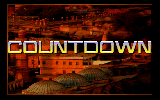
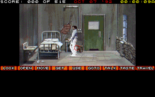
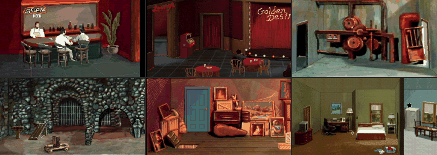
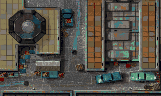
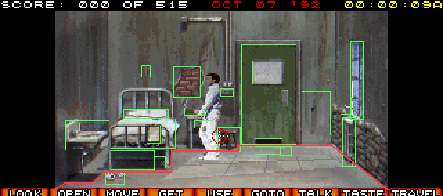
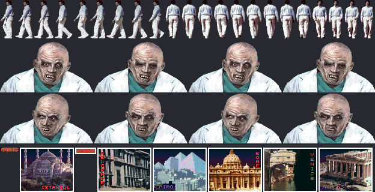
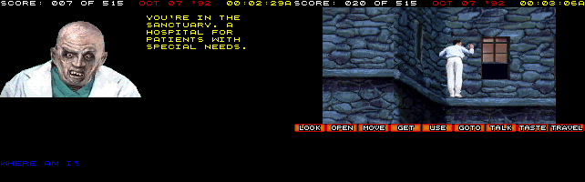
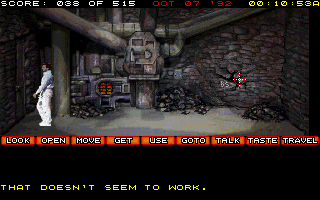
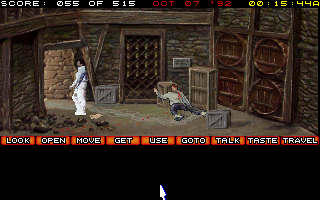
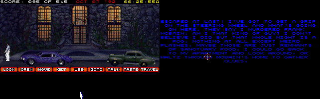

# Countdown

*Countdown* (Access Software, 1990) is what Access called an interactive movie: Mason Powers,
an American intelligence officer in Istanbul, wakes up in the Sanctuary, an asylum "for people
who know too much", with no memory of how he got there. The manual gives him 96 hours, from
midnight on Wednesday, October 7, to midnight on Saturday, October 10, and promises "something
very nasty" if he runs out. Created and designed by Brent Erickson and Chris Jones; RealSound by
Jon Clark and Steve Witzel.

## What's in the folder

| File | What it is |
|---|---|
| `COUNT.EXE` | The game, 105,205 bytes |
| `INSTALL.EXE` | The hard disk installer |
| `*.CNT` | 67 files of the game's pictures, sounds and scenes, named for what they hold: rooms and people (`MASONCEL`, the cell; `DOCTOR`, `NURSE`, `YURI`), the two flashbacks (`FLASH0`, `FLASH1`), five sounds (`SND1` to `SND4`, `SND7`), the title, two endings (`ENDING`, `ALTEND`), the font |

What's in the `.CNT` files is below, in [the files](#the-files).

## The start

`COUNT.EXE` asks two questions in text mode: how you'll play (mouse, joystick or keyboard),
and what you'll hear it on: RealSound, the AdLib, IBM's PS/2 speech adapter, the Sound
Blaster, MSound, the Covox Sound Master, or nothing. Then it switches to the VGA's mode 13h,
320 by 200 in 256 colors, for the rest of the game.

It keeps its own time. As it starts it sets DOS's time to midnight, and its date to the day it
already is, and it doesn't ask DOS for the time again: the clock in the corner of the screen, which
the manual says is "game" time, starts at 00:00. Its timer runs at 60 Hz rather than the PC's
18.2, counter 0 loaded with 19,886.

The introduction is the scream, in blue text on black ("SCREAMING... I HEAR SCREAMING... IT
STOPS WHEN I CLOSE MY MOUTH..."), the scream itself, Access's logo, and the title and credits
over the rooftops of Istanbul. Esc skips each part. Then Mason is in his cell, with the score
("000 OF 515"), the date and the clock above, and the actions below: look, open, move, get,
use, go to, talk, taste and travel.

## RealSound

RealSound was Access's way of playing recorded sound, speech and screams and music, on the
PC's speaker alone, which was only ever built to beep: "a patent protected technological
breakthrough that allows your MS DOS computer to play high quality digitized sounds ...
without adding any hardware", as the manual has it.

The speaker can only be on or off. RealSound plays a sound by how long it's on. While a sound
plays, the game sets the timer's counter 0 to interrupt every 72 ticks, 16,572 times a second,
and counter 2, the speaker's, to mode 0, where its output goes low when it's loaded and high
when it has counted down. Each interrupt loads counter 2 with the next sample, a count from 1 to
69: the speaker is off for that many ticks and on for the rest of the 72. A pulse 16,572 times
a second is too fast for the speaker's cone to follow, so it follows the pulses' average, and
the average is the sound. The scream at the start, from `SND1.CNT`, is about two seconds of
this.

Excavate's speaker had to change for it. It used to sample the speaker's signal at a few
moments in each of its own samples, 44,100 a second, as the timer was set when the sample was
made. That's fine for a tone, but here the pulses are barely three of its samples long, and
their edges folded back into the sound as noise: in the scream, about a third of the power was
the 16.5 kHz carrier, and less than a third was below 3 kHz, where the scream is. Now the
speaker counts, a timer tick at a time, how long the signal was on in each sample, and the
machine settles it before each change to the counter or port 61h, so a sample a change falls
in is counted part with the old setting and part with the new. A low-pass at about 7 kHz stands
for the cone's weight. In the same scream, the carrier is now 3% of the power and 90% is below
3 kHz. Below 3 kHz, the sound follows the counts the game wrote with a correlation of 0.996,
up from 0.98.

The other sound devices work too. The Sound Blaster asks for its port and interrupt (Excavate's
is at 220h, on IRQ 5) and is sent the scream by DMA, 16,320 bytes at 8,333 Hz. The AdLib plays it
as well.

## The files

`tools/access/countdown_files.py` reads them (see [the tools](../tools/README.md)): it lists
every part of every file, prints their text, and writes the rooms, the pictures, the cells,
the animations and the sounds as PNG, GIF and WAV files.

### The packing

A `.CNT` file is a count of its parts, a table of where each starts, and the parts, 360 of them
in the 67 files. 314 are files from the developers' own disks, packed, each with a header of
122 bytes: `MDmd`, the method, the sizes unpacked and packed, the file's DOS attributes, time and
date, a check, and its name and folder. The packing is LZW, as GIF pictures are packed: codes from
9 bits to 13, low bit first, 256 to start the table again and 257 to end. The game's own
decoder, in `COUNT.EXE`, takes its codes to 13 bits, where GIF stops at 12. The other 46 parts
are stored as they are: palettes, small tables, and 14 whole screens as GIF pictures.

So every packed part still has its name, where it was, and when it was last saved. The kinds,
by their extensions:

| Kind | How many | What it is |
|---|---|---|
| `.GPH` | 90 | Pictures of the people and things, in cells |
| `.RS` | 49 | RealSound recordings |
| `.ANM` | 43 | Animations |
| `.PLY` | 38 | The rooms' pictures |
| `.DAT` | 36 | The rooms' text and what can be done in them |
| `.COL` | 35 | Palettes |
| `.TRE` | 15 | Conversations, what Mason can say and what's said back |
| `.BAK`, `.BK2`, `.TMP` | 8 | Backups and a temporary file, packed in by mistake, by the look of it: the newspaper's text ships as `NEWS.BAK` |

The folders show the work's layout, mostly under `C:\IBM\COUNT\`, a folder for each part of the
story (`SANCT`, `ALLEY`, `GOLDEN`, `BOMB`), the sounds in `SOUND`, the palettes in `DATA`, and
some on a `D:` drive. The title's four recordings come from `D:\COUNTDEM\DEMO`, a demo's folder. The dates
run from May 14, 1990 (the title's palette) to October 10, 1990 at 12:16 (the Golden Desire
club's picture), which is, by chance or not, the date the game's own clock runs out on.

### The rooms

A room's picture is made of tiles, 16 by 16, laid out by a map. Its first 16 bytes give its
width and height in tiles, the number of tiles, the window it's seen through, and two counts.
Then come its palette (colors 0 to 127), the tiles from byte 400, and the map, a byte for each
place, the number of its tile. The colors above 127 belong to the people and the screen's
frame. A room can be bigger than its window: the cargo hold is 60 tiles wide and scrolls, the
cliff 33 tiles high, and some rooms are maps seen from above, the alley's streets, the hallways
and a maze.

Which palette a room is shown in isn't in its picture. In the game, the cell is shown in its
own colors, with `MAN.COL`, Mason's palette, above them. The ledge outside uses its own colors
too, with `WALL.COL` for Mason, a second palette for him in the same file, `TITLE.CNT`. So the
game picks Mason's colors for each scene. The game itself draws the score, the date and the
action bar, in colors 1 to 4 and 7. But a few rooms, the bar among them, look right only in a
`.COL` for all 256 colors, and we haven't been there in the game yet. The tool picks the
palette the picture looks smoothest in. One room, McBain's apartment, comes out dark either way.

After the map come the two things the counts in the header count: lines and rectangles, each
four words. The lines edge the floor, and Mason can't walk across them: the cell has 12. The
rectangles are where things can be clicked, one for each entry in the table of the room's
`.DAT`, in the same order. So a thing can be clicked in more than one place: the doctor's
office has four rectangles for its file drawers and five for its books. They're in the room's
own pixels, and the screen shows the room's window centered across it, from the line under
the score.

### The pictures

The 14 GIF pictures are the whole screens: the title, the newspaper, the map of Europe Mason
travels by, the CAD's keypad, the flashbacks, and the endings, in Paris.

### The sounds

A RealSound recording starts with 32 bytes: `STEVE`, for Steve Witzel, who wrote RealSound; how
many of the timer's interrupts each sample lasts, 2 for most, about 8,286 samples a second; `H`;
and the number of samples. Some of these headers end with scraps of x86 code where they should be
zeros, left over in the memory of the program that wrote them. The samples are the counts
themselves: in Excavate, the 32,640 counts the game loaded into the timer for the scream are the
16,320 samples of `SCREAM5.RS`, each twice, exactly. There are 42 different recordings, among
them `CRZYLAF`, `LAUGH2`, `SNORE`, six `PARROT`s, `EXPLODE`, `DIEPIG`, `IKNOW` and `LOVEYOU`.

### The cells and the animations

The people, and the things in the rooms that change, are drawn from cells, the developers'
word, kept in `.GPH` files: 1,065 of them in 90 files. A `.GPH` is a count of its cells and
where each starts. A cell is its width and height, its size, and then its pixels a row at a
time: how many to leave at the left, how many follow, and those. A row is one run from its
first pixel to its last, so color 0 isn't drawn: it's what shows through the gaps, between an
arm and a body, or a man's legs.

An animation lays cells out frame by frame. A `.ANM` is a count of its animations and where
each starts. An animation is 18 bytes, the first its kind, then a table of its frames. A frame
is its place on the screen, a word that's likely how long it's held, and what it draws, 11
bytes each: the number of the cells' file (14 for `CELLS14.GPH`), the cell, and its place from
the frame's. A few draw their cell mirrored, by the look of the tiger pit, where the same
panther walks both ways. All 359 animations in the 43 files read this way. The guard's five
are his face as he talks, his head and eyes and mouth over his white coat, and his hand coming
up to his chin. The cell's nine are its moments: the beetle crawling on the wall, a few
pixels big, which is why it's so hard to see; the guard's face at the door's window; the tray
coming under the door; the wire and the key; and Mason chipping at the screen with the knife.

`countdown_files.py cells` writes them all as sheets. The rooms' cells are in the room's colors
below 128 and Mason's or the file's palette above; the faces, the flashbacks and the endings in
their files' own palettes, or a GIF's.

### The rooms' text

A room's `.DAT` is the room's things, each with its name and what each action says about it:
the action's place in the bar (0 for LOOK, 1 OPEN, 2 MOVE, 3 GET, 5 GO TO, 6 TALK, 7 TASTE)
and the text. USE, 4, is in none of them. Its table has one entry for each rectangle in the
room's picture. The cell, for one:

| Thing | Action | Text |
|---|---|---|
| Medical chart | LOOK | THE CHARTS READS: PATIENT NAME: MASON POWERS ACCIDENT VICTIM, SEVERE CONCUSSION, MULTIPLE LACERATIONS AND CONTUSIONS. SCHEDULED FOR EXPLORATORY SURGERY- DR. FAROUK HASHISH. |
| Cross | TASTE | IS THIS SOME NEW RELIGIOUS RITUAL? |
| Radiator | TALK | PERHAPS THIS SHOULD BE YOUR PERMANENT RESIDENCE. |
| Food | TALK | YOU SAY SOMETHING TO THE FOOD AND FOR A MOMENT YOU THINK YOU HEAR A RESPONSE. |
| Writing | LOOK | A MESSAGE SCRAWLED IN BLOOD ON THE WALL. IT READS 'I MAY NOT KNOW REALITY, BUT I KNOW WHAT I LIKE!' |

Every thing is in a table but one, a door in the second hallway. Things that turn up later,
such as the knife under Mason's food, are in the table from the start, and the code decides
whether they're there. After the things come the room's messages,
numbered, which are what its puzzles say: in the cell, "USING THE KNIFE YOU CHIP AWAY THE THE
WIRE SCREEN UNTIL FINALLY IT LOOSENS ENOUGH FOR YOU TO CRAWL THROUGH AND OPEN THE WINDOW", and
"YOU TRAP THE BUG IN THE CUP AND SNAP ON THE LID." When a message is shown, and what using a
thing does, isn't in the files: the puzzles are in `COUNT.EXE`'s code ([out of the
cell](#out-of-the-cell) has one). So are the inventory's names, from DART and POUCH to DOSSIER
and EXPLOSIVE (with a SCALPAL among them).

### The conversations

Talking is by approach: Mason can ask for help, hassle, be pleasant or bluff, in any order,
and a different line comes out of each sequence. A conversation's `.TRE` has four sections,
one for each approach he starts with. Each section is a tree four approaches deep, which is why
it has 88 records: 4 + 4 + 16 + 64. The first approach is the section's record of the same
number, 0 to 3. The second leads to one of records 4 to 7, the third to one of 8 to 23 (4 + 4
× the second + the third), and the fourth to one of 24 to 87 (24 + 16 × the second + 4 × the
third + the fourth). Records 0 to 3 that aren't the section's own are copies, never reached.

A record is 8 bytes: Mason's line, the answer, the face the person makes as they give it (0 to
3), and then commands, up to a dot:

| Command | What it does |
|---|---|
| `02` and a topic | Adds the topic to ASK ABOUT ("HIS NAME IS DR. FAROUK HASHISH.") |
| `05` and two bytes | Kills Mason, by the answers it comes with ("I'M AFRAID NOT SCUM, EAT LEAD!"); not seen in the game yet |
| `08` | Ends the talk ("DROP DEAD YOU MURDERING SCUM.", and Mason is back in the room) |
| `0B` | Ends that line of questioning: the game says, in red, "I DON'T KNOW MUCH MORE ALONG THESE LINES. TRY A NEW APPROACH." |

A record with none goes on. The rest of each record, and the records past each tree's end, are
leftovers from the editor they were written in: dots, commas and digits. In the game, HELP,
HELP, HELP, HASSLE with the guard gives records 0, 4, 8 and 25, one of the sequences the
manual's beginners' tips suggest. The last is "CONFIDENTIAL! WHO THE HELL DO YOU THINK I WOULD
TELL. GIVE ME A BREAK HERE!", answered with "WELL... I GUESS IT WOULDN'T HURT TO TELL YOU. HIS
NAME IS JACK QUINN." Its commands are `02 12 0B`: JACK QUINN goes on the list, the score goes
up a point, and the line ends.

Then come the lines, in three blocks: what Mason says, what he's told, and the answers to ASK
ABOUT, each with the topic it answers and a face. The topics are 28 names in `COUNT.EXE`, from
ACCIDENT and MASON POWERS to THUNDERBOLT, BLACK DECEMBER and the DEC. MANIFESTO. Asked about
STORMBRINGER, Lisa Loomis says "THAT'S THE NAME OF MCBAIN'S 'MYTHICAL' MOLE WORKING INSIDE THE
CIA"; asked about JACK QUINN, "JACK QUINN HAD YOU PUT AWAY."

### The newspaper

The paper, *The American Eagle*, has a President Thomas Carroll losing his lead to L.J.
Leeland, a former NATO commander, over terrorism, ahead of a summit on terrorism in Paris.

## Out of the cell

With the mouse, clicking an action and then a thing puts them on the command line, and
clicking the thing again carries it out. A long message holds the game, the clock
included, until the next click. The way out of the cell follows the manual's beginners' tips:

1. GET the CUP by the sink.
2. USE the CUP ON the BUG, a rhinoceros beetle on the wall by the door: "YOU TRAP THE BUG IN
   THE CUP AND SNAP ON THE LID."
3. TALK to the guard. His face is at the door's window for a second or two, about once a
   minute, and he can only be talked to then.
4. OFFER him the bug: "I HAVE BEEN LOOKING EVERYWHERE FOR A RHINOCEROS BEETLE! I'LL HAVE SOME
   FOOD SENT TO YOU RIGHT AWAY." When Mason leaves the talk, a tray comes in under the door,
   and under it is a knife.
5. GET the KNIFE, USE it ON the WINDOW on the right, which chips its wire screen away, GET the
   locker KEY at the foot of the bed, and GO TO the WINDOW.

Mason climbs out onto a ledge, high over the water, with 20 of the 515 points.

The knife was the hard part, and the code shows why. USE with the knife (item 5) on thing 12,
the window, says "YOU'RE NOT CLOSE ENOUGH TO DO THAT" unless Mason is at 180 or more across,
and between 44 and 64 down, a little out from the back wall. The sandbags under the window keep
him from going farther right along the wall itself. And the mouse won't take him there: it
walks him the longer way first, then the other, and stops for good at the first line in the
way. Sent toward the window from the back of the room, he walks right along the back wall
until the floor's corner stops him, and never comes forward. The arrow keys walk him one step
at a time, so a little down and then right gets him there. Around it, the code checks the
other USEs the same way, the item and the thing by number, and keeps a flag for each change in
the cell: the bug caught, the key taken, the screen chipped.

## Through the Sanctuary

The game's rooms are numbered as their pictures are, `ROOM20.PLY` being room 20, and some
share a file: rooms 11 and 16, two cells, are both drawn from `CELL.CNT`. For each room the
code has a routine for each action, kept in tables of 52, one entry for each room number: one for
LOOK, one for OPEN, one for MOVE, one for GET, one for GO TO, and so on. Another routine for
each room says which of its rectangles can be clicked just then. They know things by their
rectangle's number, and keep a flag for each change: a door opened, a key taken, a rock moved.
That's where the puzzles are, and reading them is quicker than guessing.

The ledge is 768 pixels wide and scrolls as Mason walks it. Of its windows, the fourth "HAS
NOT BEEN LATCHED", and opens into room 16, a cell whose door opens onto the floor's hallway.
The hallways are maps seen from above, a floor each, with stairs between the floors at their
top left. A guard walks each, and if he catches Mason: "AFTER BEING CAPTURED BY THE HALL GUARDS
YOU RECEIVE A LOBOTOMY. YOU SPEND YOUR REMAINING YEARS TRYING TO FOCUS ON A SINGLE OBJECT." And
the game starts again. How the guards walk and see is in [getting away](#getting-away).

Down the left corridor is room 11, Barney Sacnussen's cell: his self-portrait on the wall, and
behind it, written on the wall, "AT NIGHT WHILE THEY SLEEP; PASSED THE FIRE AND INTO THE WALL
I CREEP". Moving the pillow shows a homemade key, "FASHIONED OUT OF SHEET METAL". The stairs
go down two floors to a landing, room 0, whose one door is locked, and the homemade key opens
it on the furnace room, room 1. Moving the coal there shows a pick axe, and the pick opens
the patched hole in the far wall, used from close to it. But going through needs a light:
"IT'S WAY TOO DARK FOR YOU TO NAVIGATE. YOU WOULD GET LOST." The code gives it to GET in room
8, behind one of the doors on the floor below the cells.

Rooms 6 and 8 are two operating rooms, both drawn from `SURG.CNT`. In room 6 a scalpel is
stuck in the dart board, and GET pulls it out ("IT LOOKS QUITE THREATENING"; the inventory
calls it a SCALPAL). In room 8, opening the box on the floor shows the flashlight.

And there's a clock on all of it. Climbing out of the window starts a timer of 36,000 of the
game's sixtieths of a second, ten minutes, and going back into the cell stops it. When it runs
out: "THE GUARD OUTSIDE YOUR DOOR FINALLY NOTICED YOU WHERE MISSING AND SOUNDED THE ALARM.
YOU RECEIVE A LOBOTOMY THE NEXT MORNING AND SPEND YOUR REMAINING YEARS TRYING TO FOCUS ON A
SINGLE OBJECT." So the way down has to be known before it's taken.

Through the hole are the catacombs, room 3, a maze of tunnels in the rock seen from above, 672
by 512 pixels through a window of about 130 by 100, with stone coffins and pools of stagnant
water. The way across, worked out from the room's 370 floor lines, is about 2,200 pixels of
walking, a minute and a half. The first time through, we'd spent too long getting there to
have it, so for looking further we gave the timer back its ten minutes in memory, as a debugger
would. The way out below was played honestly, within the time.

The far side is a wine cellar, room 2. A dead man sits against the crates, his head covered in
blood, and beside him, written in blood, the initials B.S. A plaque says the monastery was
founded in MCDXXXIII. Another is too dirty to read, and a rag found there cleans it: "SINCE WE
FOUNDED THIS PLACE SO CLOSE TO THE SEA WE'VE NEEDED A WAY TO ESCAPE QUICKLY. FOUR BOTTLES OF
WINE MOVED IN ORDER BY THEE OPENS A PASSAGE WHICH SETS YOU FREE." The rack holds sixteen
bottles, four rows of four, and the code wants, in order, the first bottle of the first row,
the fourth of the second, the third of the third and the third of the fourth: 1, 4, 3, 3, the
year. Any other bottle starts the count again. "YOU HEAR A LOUD CRACK AS THE FAR WALL SLIDES
OPEN, REVEALING A DOORWAY", and it opens on the foot of a cliff over the sea, room 25. Climbing
it takes what Mason doesn't have yet: shoes that grip, and a grappling hook and rope.

## Getting away

Everything for the cliff is back up in the Sanctuary. The locker room, room 22, and the storage
room, room 21, are off the hallway of the floor above the cells, room 23, up the stairs. In the
locker room, moving the towel on the bench shows another locker key, which opens the locker with
the mountaineering boots ("WHICH COINCIDENTLY, ARE YOUR SIZE"). Mason's own locker key, from the
foot of his cell's bed, opens the other, with his bag: his wallet, an I.D. card with his name and
address, three dollars, and the address of Frank McBain. In the storage room, a crowbar pries
open a box "LABELED ACME MOUNTAINEERING SUPPLIES", with a stainless steel grappling hook and
rope inside. And the car the cliff leads to wants keys: the key ring on the desk in the doctor's
office, room 4, off the floor below.

That's too much for ten minutes, but going back into the cell stops the clock, so it takes more
than one trip. Ours took three, each coming back by the ledge: the homemade key, the boots and
the hook; then the flashlight and the car keys; and the last went straight down: the landing, the furnace room, the
pick, the catacombs, the cellar's bottles, the cliff. At the foot of it, in the boots, GO TO the
wall, standing below the notches, and Mason climbs; near the top, USE the hook on the overhang: "YOU
TOSS THE GRAPPLING HOOK UPWARDS. THE HOOK CATCH THE ROCKLEDGE AND WITH GREAT EFFORT YOU CLIMB TO
THE TOP." The top is the front of the Sanctuary, room 26, with two cars, and the keys start
the 1983 Thunderbird: "ESCAPED AT LAST! I'VE GOT TO GET A GRIP ON THE STEERING WHEEL AND WHAT'S
GOING ON HERE. THEY SAY I MURDERED FRANK MCBAIN." Once he's away, the clock no longer matters.
Mason has 95 of the 515 points, and it's 25 minutes past midnight.

The guards made it hard until their code was read. Each floor's hallway has one guard who can
catch Mason, the only one the code checks there, and he walks a fixed script, round and round:
a list of steps, each a direction and the place to walk to, or a pause. He walks on while Mason
is in a room. He catches Mason if he comes within 16 pixels of him both ways, or if Mason is
ahead of him, within 16 pixels to either side of his path: up to 96 pixels when he faces up or
down, and 192 when he faces left or right. Behind him is safe, and so is 17 pixels to his side.
So the hallways come down to timing: wait in a room, or at the stairs, until his back is turned,
then go. The scripts loop in about a minute on the floor above the cells, and nearer two on
the others.

### A sound past the end of the list

On the lower floor the game froze, the first time it was played through there, on a divide by
zero. Room 10's code picks a sound to play at random, a number from E10h to 2A30h of which
it means to keep two bits. When those two bits are 0, it jumps past the line that clears the
rest, and asks for sound 1 plus the random number's low byte: EBh, say, past the end of the
list. The list's entry there is 0, so the player takes the sound to be at 0000:0000, the start
of the interrupt table, and its rate from the byte at 0000:0005, the high byte of INT 1's
offset. It divides by that rate. On an IBM PC, INT 1 and the other vectors no one uses point
at an IRET the BIOS keeps at F000:FF53, so the byte is FFh, and a sound nobody hears plays
for a moment. Excavate pointed them at an IRET at F000:0000, so the byte was 0, and the
division faulted, and returned to itself, over and over. Its vectors now point at F000:FF53, as
IBM's do.

## Still to look at

- The animations' kinds, the rest of their 18 bytes, and the word after each item: how the
  code picks and plays them.
- The rest of the puzzles in `COUNT.EXE`, room by room, and how a conversation opens ASK ABOUT
  and OFFER.
- Which rooms take a `.COL` for all their colors, and where the game picks it.
- A test that plays the whole escape, timing the guards from their scripts.
- The rest of the game, from the travel screen on.
