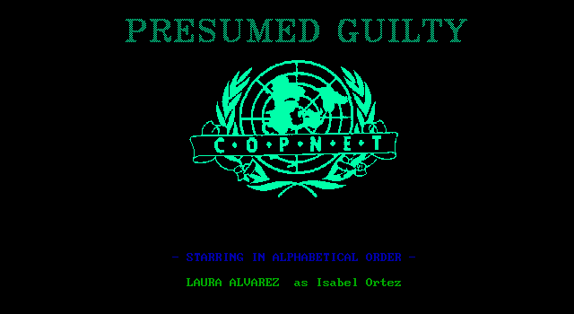
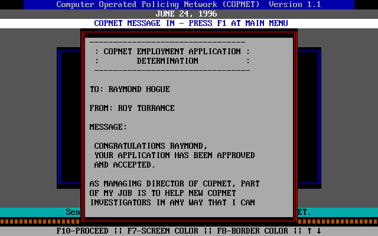
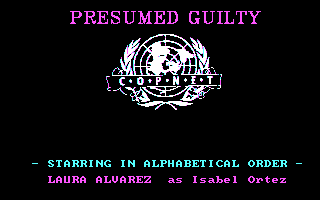

# Presumed Guilty

*Presumed Guilty* (Cosmi, 1989) is built on *The President Is Missing*: the same kind of
network of menus, messages, dossiers and photographs, the same setup and profile, now COPNET,
the Computer Operated Policing Network, with DNA analysis added. The copy here is a later release, Celery Software's,
whose manual update is dated October 8, 1993.



## What's in the folder

| File | What it is |
|---|---|
| `PGMAIN.EXE` | The game, 37,904 bytes |
| `SU.EXE` | Setup, 4,119 bytes, which makes your profile |
| `SA`, `SA.B` | The profile, and the profile as it shipped |
| `MSG.TXT`, `RECORDS.FIL` | The messages and the records, in the President's encoding: each byte rotated right one bit |
| `STATUS.TBL`, `CF.FIL` | The case as it stands, with `STATUS.TBB` and `CF.FIB` as they shipped |
| `SYNO.FIL` | Written by setup, beside the profile |
| `*.PCC` | The pictures: the title, mugshots, photographs, DNA |
| `GO.EXE`, `GO.CFG` | Celery's menu: setup, play, reset |
| `PG.BAT`, `RESET.BAT`, `SAVE.BAT`, `RESUME.BAT` | Play, start over, and keep or bring back a game under a name |
| `floppy\` | The release's floppy: `INSTALL.EXE` and its data |

`GO.CFG` sets out Celery's menu: "Setup Presumed Guilty", "Play", "RESET", and the line "It's
not shareware!". `SAVE.BAT` copies `CF.FIL`, `STATUS.TBL` and `SA` into a folder of the name
given, and `RESUME.BAT` copies them back: a saved game is those three files.

## Setup

Setup is the President's, changed. It no longer asks which drives you have, or for your
address, and it doesn't ask for the codephrase either, though the prompt is still in it
("ENTER 20 CHAR CODEPHRASE (NO SPACES)"). It shows COPNET's employment application, signed by
its managing director, asks your last and first names, and gives the passphrase away:
"Memorize your passphrase. It is \*IT\*RAINS\*IN\*SPAIN!\*". Then it writes `SYNO.FIL` and
`SA`, and exits with the drive's letter, 'C', as the President's setup did.

```
excavate guilty SU.EXE
```

The profile is the President's too, but where the President keeps your code name, this one
keeps your passphrase: setup writes `*IT*RAINS*IN*SPAIN!*` there, 20 characters. In place of
the address it no longer asks, it writes a row of `s`'s for the street and `c`'s for the city.
`SYNO.FIL` looks to be a list of the names the game knows for each thing you can
investigate, the first of them yours.

The profile eXoDOS gives you was made otherwise: its passphrase is 20 B's, its address
`FA`, `FASDF`, and its name Raymond Hogue. Ray Hogue wrote the President's MS-DOS version.

## The game

It asks for the display, "ENTER 1 for CGA; 2 for EGA; 3 FOR TANDY", shows its title and
credits, and goes straight to COPNET's main menu, on June 24, 1996. There's no logon in this
release. The first message waiting is that letter of acceptance, addressed to the profile's
name.



A new case starts with an empty database: the dossiers say "> NO RECORDS <", and DNA
analysis, drawn in the EGA's 640-by-200 mode (0Eh), says "NO DNA SAMPLES AVAILABLE". Judging by
its messages ("PHOTOGRAPHIC DATABASE HAS BEEN UPDATED"), the case fills them in as it goes
on. Logging off saves `STATUS.TBL`, `SA` and `CF.FIL`.

`MSG.TXT` holds every message, in the President's encoding, each ending in a `|`: a line with
its name, a letter and a number, the names of the messages it leads to, and after a `~` its
text. In the text, `^F` and `^L` stand for your first and last names. `STATUS.TBL` lists the
messages and the things you can investigate, one record each: a letter for the kind, a
ten-character name, a letter for where it stands, and where its text starts in `MSG.TXT`.

## The Umbra files

*This section and the next give away codes and part of the plot.*

The database's fourth choice is "UMBRA CLEARANCE REQUIRED", the sequel's Top Secret files. It
asks "ENTER UMBRA CODE (ALL UPPERCASE) OR ENTER TO EXIT", and the code is `CHAMBERLAIN`,
stored as plain text in `PGMAIN.EXE`. The check is the President's routine again: it compares
your answer as far as the code goes and no further, so `CHAMBERLAINS` gets in too.

The code doesn't show a file. "UMBRA CLEARANCE ESTABLISHED" flashes, and the game goes
through `STATUS.TBL` turning each record marked `U` to `D`. Six things you can investigate are
marked `U` as the case ships, HACKER, BUCKS, CHAMP, GR-13, MAINFRAME and SLAM: they're what
the clearance opens.

A wrong code gets "!! WARNING - 3RD UNAUTHORIZED ATTEMPT CAUSES TERMINAL DEACTIVATION !!",
and the game counts. The first sets up a message named `FUMBRASUGG`, which is from Falcon:

```
I NOTICED YOU TRYING TO GET INTO THE
UMBRA FILES AND I THOUGHT YOU MIGHT LIKE
MY HELP.  THE UMBRA ACCESS CODE IS

          "DO IT TO ME"
```

It isn't. Typed, it's another wrong code. The third sets up `CUMBRATERM`, "TERMINAL
DEACTIVATION NOTICE", which leads to the end of the game: COPNET deactivates your terminal and
issues a warrant for your arrest. Those two messages are what the code sets up; I haven't
played on to see them arrive. Once cleared, the game stops counting.

## The passphrase

The passphrase is the game's clock. Falcon, the voice behind the plot, is cracking it a
character at a time, in a chain of messages that come at intervals:

```
HERE'S THE 7TH CHARACTER OF YOUR
PASSPHRASE ^F.  ONLY 13 MORE TO GO AND YOUR
HISTORY!
```

Some come with a riddle about the case. When one arrives, the game marks that character in
`CF.FIL`, 20 bytes, one for each character, and shows your passphrase with a `-` for each
character he hasn't found. When he has them all, he gives your address to COPNET,
and the game ends with your arrest. Changing your address puts him off: "THAT WAS MOST CLEVER
OF YOU TO CHANGE YOUR ADDRESS".

So the passphrase is never typed. The prompt "- PLEASE ENTER YOUR PASSPHRASE BELOW -" is in
`PGMAIN.EXE`, but nothing in the program that I could find refers to it, like setup's codephrase prompt: what
the release shows of a logon it took out.

## How the case runs

Every entry in `MSG.TXT` begins with a line like `NRAYDEATH- N 00010`: its name, a letter for
where it stands, and a wait in seconds. The lines after it, up to the `~`, name the entries it
sets off. `STATUS.TBL` keeps the same entries, 27 bytes each: the name, the letter, the wait in
timer ticks (18 a second, so 10 seconds is 180), where the text starts in `MSG.TXT`, and when
its wait began.

The letter is a state, and the game moves each entry through them:

| Letter | What it means |
|---|---|
| N | Not yet |
| D | Open: for a report, something you can investigate |
| U | Locked until Umbra clearance |
| I | Falcon's, sent at once when set off |
| C | Falcon's, timed when set off |
| T | Timing |
| R | Arrived |
| Q | Announced |
| A | Read |
| Z | Done |

Reading an entry sets off the ones it names, and what that does depends on their kind. News and
COPNET's messages start their wait. Falcon's are sent at once, or timed if marked `C`. Reports
in `N` become open (`D`), and start their wait only when you investigate them, typing their
name under COPNET COMMUNICATIONS, TRANSMIT. Dossiers and photographs go straight into the
database. Then the timer's interrupt looks at one entry a tick, and when an entry's wait is
over it marks it arrived and puts up its notice: "NEWS FLASH", "COPNET MESSAGE IN", or
"INVESTIGATION RESULTS AVAILABLE". Falcon's are flagged to be shown
on their own.

The case ships with one entry arrived, the welcome letter, and it sets off the rest: 19 reports
opened, Falcon's introduction, and the news of a death that starts the case proper.

### Falcon's chain

The passphrase is cracked by a chain of 21 of Falcon's messages, `FX00` to `FX19` for the
characters and `FX004` for the whole, each setting off the next. It's started by `FADDRCHNG`,
"MOST CLEVER OF YOU TO CHANGE YOUR ADDRESS", which is set off by evidence file X867: the case
against you, listing you first among the suspects to be "PRESUMED GUILTY". The waits add up to
38,500 seconds, about 10 hours 40 minutes, and each starts only when the message before it is
read. Along the way the chain also sets off news of a second murder and more; at its end it
sets off `CTERMINATE`, and the game is over.

### BETAFAST

The makers left themselves a way to hurry it all. `BETAFAST` is a report open from the start:
transmit it as an objective, and four seconds later its results say "FOR BETA-TESTING, YOU
HAVE REQUESTED ALL MESSAGES TO OCCUR WITHIN 5 SECONDS. THIS WILL BEGIN UPON LEAVING THIS
MESSAGE. TO RETURN TO NORMAL TRANSMIT "BETANORM"." Reading it sets off `SB00`, a switch, and
from then on every wait that starts is 5 ticks, about a quarter of a second. In Excavate,
investigating General Wharton after it took 5 ticks, not the 90 it ships with. The switch is
kept in memory, not in the files, so it should last only until you log off.

`tools/cosmi/guilty_case.py` prints all of this from the game's files: the case entry by entry
under what sets each off, any one entry, or Falcon's chain with its times.

## Reading it without playing

Excavate can show every message, dossier and report the case holds, and the cassette's
transcript, from your copy of the game, without playing it:

```
excavate guilty --documents         all 323, by number and name, grouped by kind
excavate guilty --documents 21      Falcon's first message
excavate guilty --documents all     every one
```

Each entry in `MSG.TXT` is named, and the name's first letter is its kind:

| Letter | Kind | Entries |
|---|---|---|
| C | COPNET's messages | 20 |
| F | Falcon's messages | 30 |
| N | The news | 18 |
| D | Dossiers | 32 |
| M | The mugshots' entries: a picture's file, a number, a name | 39 |
| P | The photographs' captions | 13 |
| O | Reports on what you can investigate | 162 |
| S | Notes on the messages | 6 |
| R | Remarks | 2 |

The transcript is in `RECORDS.FIL`, in the same encoding: the audio evidence
("on cassette", as the database menu says), written out. The player shows `^F` and `^L` as they are, where the game
puts your names.

The last two kinds look to have been left in by its makers. Two notes say how a
status is set, "SET BY TRANSMITTING "BETAFAST"" and "BETANORM", and one that `S00` "IS CALLED
FROM CTERMINATE AND IT CAUSES TERMINAL DEACTIVATION". The remarks are "JUST A SPACER BETWEEN
THE TWO AITKENS" and "THE FOLLOWING IS FROM THE LAST DISK FROM CARIE".

One report, `OHOARE SAM`, has no `~` before its text; the player takes its text from after
the line naming it. How the game shows it is still to see.

## A way around a logon that isn't there

The President's `!!` is here too. The routine that checks an answer starts with
`cmp word ptr [bx], 2121h`, and on two exclamation marks sets a flag and skips the rest, as
the President's logon did. But nothing calls the routine, and nothing reads the flag: the
one other place that touches it clears it. It's the President's logon, left in
when this release took the logon out, with the prompts for the codephrase and the passphrase.
Typing `!!` anywhere in Presumed Guilty does nothing it wouldn't otherwise.

## What it asks of the PC

- **The EGA, or the CGA, or a Tandy.** On the EGA, the title and credits are in mode 10h, the
  menus are text, and DNA analysis is mode 0Eh, with its picture, `DNA.PCC`. On the CGA, the
  title is in mode 4, four colors, and DNA analysis is text, without the picture: the game
  chooses so. Asked for the EGA, it looks at 0040:0087h, as the President does, and uses the
  CGA if that's 0.
- **Names padded with spaces,** as the President's are: it opens `PGTITLE .PCC`.
- **The BIOS's IRET at F000:FF53h,** for its timer hook, as the President does.
- **Nothing on drive A:.** eXoDOS mounts the floppy as A:, but the game runs from its folder,
  and in what's been played so far it never looks there. Its "PLACE DISK 1 IN DRIVE" is for logging off when it can't find
  `SA` to save the profile, as when it's played from floppies.



## The Tandy that isn't

"3 FOR TANDY" gets the CGA. The game sets a flag for it, and then does just what it does for
the CGA: mode 4 for the title, text for the rest. One place reads the flag, the start of the
routine that plays its music on the PC's speaker:

```
cmp byte ptr [15B0h], 'Y'    ; the Tandy?
jne next                     ; to the instruction after it, either way
nop
nop
nop
nop
next:
```

Whatever the Tandy got there, most likely its own sound chip, three voices to the speaker's
one, has been taken out, leaving room for it. This release's Tandy is a CGA, with the
speaker.

## A byte that goes astray

To set the EGA's data rotate register, the game writes the register's number, 3, to the
graphics controller's index port, 3CEh. Then it moves to the data port, 3CFh, and writes the
value with `out dx, ax`, two bytes. The first, the value, goes to 3CFh, as meant. The second,
whatever was in AH, goes to the port after, 3D0h, which nothing on an EGA answers. AH holds
half of the two-letter code the value was chosen by, a space (20h) when drawing the title. It
works, by accident; Excavate's log notes the write to 3D0h and goes on.

## What Excavate does

Nothing it didn't already: the game runs as it is. It ends with exit code 2, the number of the
text mode it sets as it leaves, still in AL; the player reports it as it would any other.
