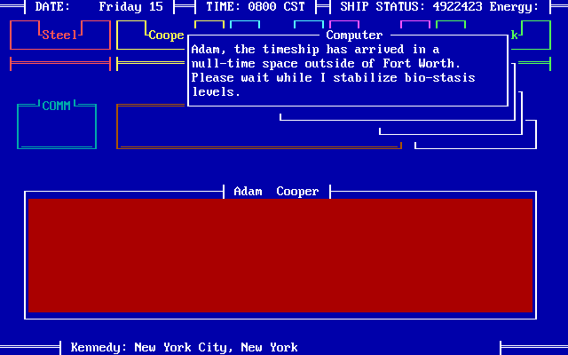
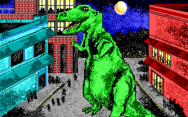
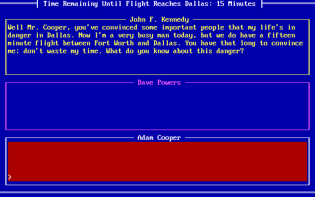
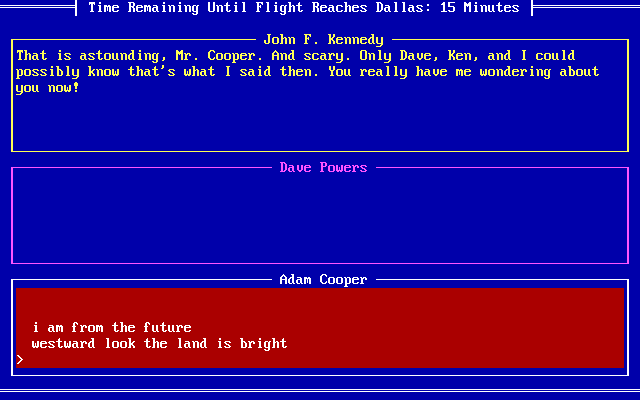

# Guardians of Infinity: To Save Kennedy

*Guardians of Infinity: To Save Kennedy* (Paragon Software, 1988). You direct a timeship and its
crew, sent back to stop the assassination of John F. Kennedy. The box held a novella, a reference card and a registration card, which a copy of the
game today keeps as PDFs beside it.

## What's in the folder

| File | What it is |
|---|---|
| `KENNEDY.BAT` | How it's started: runs the game, then, by its exit code, the ending or a prompt to play again; `KENNEDY SETUP` chooses the display |
| `GOI.EXE` | The game, 153,152 bytes |
| `RUND.EXE` | The ending: your talk with Kennedy on Air Force One, and how it all turns out |
| `KSHOW.EXE`, `SHOW.DAT`, `JFKT1`, `P` | The "Top-Secret Slide Show": the story before the game, in pages of text and pictures |
| `K.DAT` | The ending's dialog: what Kennedy and Dave Powers answer to what you type |
| `$RUN.OVL`, `$KS.OVL` | The display's overlays: setup swaps them, for a "fast" adapter or a "slow" CGA that shows snow |
| `SYS$MSG.DAT` | The interface library's messages |
| `GETKEY.COM` | Waits for a key and exits with it, for the batch file |
| `MIRKWOOD.DAT` | The 96 missions to see someone: what the agents say on each, and its script |
| `SHERWOOD.DAT` | The game's other 13 missions, among them going after Oswald and his rifle |
| `NWS` | The news (F6), and the help (F1) |
| `GOIDAT.SAV` | A saved game, not yet looked at |

`GOI.EXE`, `RUND.EXE` and `KSHOW.EXE` were built with Turbo C (Borland, 1987). The game and
`RUND.EXE` are also built on C-Worthy, an interface library by Custom Design Systems of Provo,
Utah: its windows, its overlays, and `SYS$MSG.DAT`, a "C-Worthy (R) Message Librarian Data
File".

## What it asks of the PC

Two things a PC of 1988 didn't have, both asked by C-Worthy, and both answered as such a PC
answers them:

- **NetWare's shell.** It calls INT 21h function EAh, AL 01h: the version of the NetWare
  shell, Novell's network software, which fills in a buffer with its system's name and
  version. Novell later bought C-Worthy and built its own utilities on it. Without a network
  there's no shell, and DOS answers as for any function it doesn't have: AL 0 and nothing
  else. The game had cleared the buffer first, and goes on with empty names.
- **A multitasker's screen.** It calls INT 10h function FEh, TopView's, which DESQview and
  Windows also answered: given the screen's address in ES:DI, a multitasker hands back a
  buffer of its own to write in. With none, the BIOS doesn't know the call, ES:DI are left as
  they were, and the game writes the screen itself.

It also points interrupts 34h to 3Dh at itself: Turbo C's emulator, for floating point with no
8087.

## What Excavate does

It answers both calls as DOS and the BIOS did, and notes them in its log. With that, the game
starts from its batch file and draws its screen: the date, Friday 15; the time, 0800 CST; the
timeship's status; and its computer's first word, "Adam, the timeship has arrived in a
null-time space outside of Fort Worth."

The slide show and the ending need nothing more.

## The slide show

The batch file doesn't run `KSHOW.EXE`: you run it yourself (`excavate kennedy KSHOW.EXE`).
It's the story up to the game's start, Adam Cooper's mission log from his time sphere outside
Fort Worth on November 15, 1963: time anomalies in the 2080s, the rogue time traveler who
engineered the assassination, the stolen Time Sphere. It takes a key a page, and returns to
DOS with exit code 3 after "END OF ENTRY." On a monochrome card it refuses to run.

It draws in the EGA's 320 by 200 mode in 16 colors, or, on a CGA, in its 320 by 200 mode in
four. Its pictures are IFF ILBM files, the picture format of Electronic Arts' Interchange File
Format, which the Amiga made common: `JFKT1`, the title, and the ten in `P`, one after another
in the one file. Each is 320 by 200 in four bit planes, compressed, with a chunk of Paragon's
own besides the standard ones: `CCGA`, two bytes, which differ from picture to picture and look
to give the colors it's shown in on a CGA. Strings left in `KSHOW.EXE` ("Adding CGA info to EGA
IFF ILBM file", "Raster width", "Color register") show it was built from Paragon's tool for
making and checking these files.

`SHOW.DAT` is the show's script and its text. It starts with 1Ah, then two words: the script's
length (739 bytes) and the text's (4,508), which follow in that order. The text is lines ended
by a zero, and the script is one-letter commands:

| Command | What it does |
|---|---|
| `t` | Starts a page of text |
| `d` and a word | A line of the text, at that offset in it, as it is |
| `c` and a word | A line, centered |
| `p` | Waits for a key |
| `g` and a double word | Shows the picture at that offset in `P` |
| `z` | The end |

The show is 14 pages of text and 10 pictures. Any other letter stops it: "ABORT: Illegal
instruction".

## How the game hands over to its ending

When the game ends with you on Air Force One, it exits with code 2, and the batch file runs
`rund Z k0`. `RUND.EXE` won't run any other way: given other arguments, or started by itself,
it says "Bad command or file name", as DOS would, and exits with code 1.

It also needs a token from the game, left in memory. The BIOS keeps 16 bytes at 0000:04F0
(0040:00F0) as an "inter-application communication area": nothing of the BIOS's or DOS's own
is kept there, and one program can leave something there for the next. As it exits, the game
clears the area, then, for the three endings that go on to Air Force One, writes in it:

| Bytes | What |
|---|---|
| 0 to 9 | `1012ABACAB` |
| 10 | Whether the sound is on |
| 11 | Which of the three it was, 0 to 2: by what the ending does with it, how many of your agents are still out in the field (none, one, or more) |

`RUND.EXE` checks for `1012ABACAB` and reads the two bytes after it, then clears the area, so
the token is good for one run. The last byte decides a line of the winning ending: "The
President listens to your predicament with your one agent" (or "agents"), and helps find them.

The ending opens on Dave Powers, who has heard the same story from three people and arranged
a meeting on Air Force One, en route from Fort Worth to Dallas. Then it's a conversation, with
Kennedy in the top window, Powers in the middle, and you typing in the bottom. Its credits:
"Kennedy Dialog Programming by Thomas J. Holmes" and "Kennedy Dialog Written by John Antinori
and Bill Snyder".

## The conversation

The flight is 15 minutes, counted down on the screen as you talk. In them, you have to
convince Kennedy that you're from the future, by telling him things only he and the people
closest to him could know. Each one
he can't explain is worth one to three points, and six convince him. `RUND.EXE` runs the
conversation, and `K.DAT` holds it. `tools/paragon/kennedy_dialog.py` prints all of it, and
`--points` lists every answer that gives points (25 in all), with what to say for it.

### What you type

`RUND.EXE` cuts what you type into words, everything but letters, digits, `'` and `-` being a
space between them. It replaces some words with others, from a table of its own: "kennedy",
"president", "john", "you" and "your" become "jfk"; "assassin", "gunman" and "gunmen" become
"oswald"; misspellings it expected are corrected ("veitnam", "hienekens", "kruschev"); and
"shit", "dirtbag" and their like become one word, which Kennedy has an answer for. The
patterns are written in those words: "jfk_are_my_kind_of_shah" is "you are my kind of shah".

A pattern is words in an order. Words with a space between them have to come in that order,
with anything between them; words joined by `_` have to come one right after another.
"jfk life danger" matches "Your life is in danger in Dallas"; "westward_look_the_land_is_bright"
needs the line as it was said.

Not every pattern can match. The table turns "gunman" and "gunmen" into "oswald" before the
patterns see them, so "gunman grassy_knoll" and "gunmen grassy_knoll" never match: in the
running game, "a gunman on the grassy knoll" gets the answer for nothing matched. "attempt to kill jkf" has a typo, and
matches only if you make the same one.

### How an answer is chosen

`K.DAT` is five sections, each with its opening line, its patterns, and its answers in order.
Each answer is for sets of patterns, any one set of them; a set is one pattern or several, all
of which have to have matched. It goes through them twice:

1. **For what you just said.** The first answer, in order, whose set matched this time and
   whose conditions hold is the one given.
2. **For what you've said before.** If none was, it goes through again with everything you've
   said so far. Some answers are only for this pass: they bring back a subject ("You mentioned
   Krushchev before. Do you have anything else to say involving him?"). The answers for when
   nothing matches come in here too.

So a set of several patterns can be said over several lines: "1960", "convention" and the
six things they had for breakfast at it are one answer, worth two points.

### What an answer does

An answer is a string of commands, a letter each, some taking a string between delimiters:

| Command | What it does |
|---|---|
| `k/text/`, `d/text/` | Kennedy or Powers says it |
| `+n`, `-n` | Gives or takes away points; at six, Kennedy is convinced |
| `?/n/` | Goes on only if you've never said pattern n |
| `u/n/` | Forgets you said pattern n; `c` forgets everything |
| `f/n/` | Sets flag n; `=/n/` goes on only if it's set, `#/n/` only if it isn't |
| `g`, `n` | Goes on only in the second pass, or only in the first |
| `^` | Is said once: the answer is taken off the list |
| `>` | Goes to the back of the list, so the answers for nothing matched take turns |
| `r/name/` | Goes to another section |
| `e` and a letter | Ends it: `0` or `t` Kennedy goes on to Dallas; `1` he turns back, with you |
| `!` | Never goes on |

A condition that doesn't hold stops the answer before anything is said, and the next one is
tried.

### The file

`K.DAT` starts with 1Ah, a word, and the number of sections, then each section's name (13
bytes), its length (a double word), a byte, and its place in the file (a double word). A
section starts with a word, then the number of its patterns and each one's place; the number
of its answers and, for each, the place of its sets of patterns in the section's table and
the place of its script; and the table's place. All the places count from the end of that
header, where the opening line starts. The text, the opening line, the patterns and the
scripts, is strings ended by a zero, every byte XORed with 1Ah. The table isn't: it's the
number of its words, then for each answer the patterns of its sets, FFFFh after each set and
FFFEh at the end, with FFFDh for nothing matched.

### The sections

- **`k0`, the opening.** "What do you know about this danger?" Talk of Oswald or the Book
  Depository takes you to `k1`; saying you're from the future takes you to `k3`.
- **`k1`, the plot.** "Were you part of the conspiracy?" Say yes, and Kennedy turns back for
  Washington, but takes you with him. Say no, and it goes on to `k2`; contradict yourself twice,
  and he gives up on you. Saying you're from the future goes on to `k3`.
- **`k2`, the source.** Then how do you know about it? Admit you were part of it after all, and
  it ends as a yes in `k1`; say you're from the future, and it goes on to `k3`; say nothing he
  can use three times, and he goes on to Dallas.
- **`k3`, the future.** "Convince me you are from the future." The heart of it: 101 answers to
  125 patterns, about his family, his staff, his habits, and the crises of his presidency.
  Most of them he can explain away: it was in the papers, or anyone in his office could have
  seen it. Fifteen give points. Three points each: a line, "westward look, the land is
  bright", that only Powers, O'Donnell and he could know he said; Khrushchev's letter about the
  "knot of war"; and the Gold Star Mothers, with where Powers and Kennedy first met. Two each:
  a frappe in Boston on a secret ice cream run, the bomb shelter passes of the Cuban missile
  crisis, his breakfast at the 1960 convention, and "I'll get you, you so help me God". The
  rest give one.
- **`kt`, the landing.** When the time runs out, Air Force One lands in Dallas. "Why should we
  trust you?" Powers suggests changing the route and searching around the Book Depository, but
  whatever you say next, Kennedy goes on: "Future, Dave? Really!!"

So "I am from the future", "Westward look, the land is bright" and "Krushchev's letter: the
knot of war" win it in three lines.

### How it ends

With six points, Powers or Kennedy agrees that you've been convincing, and the President calls
off Dallas:

- **The win.** On landing at Love Field, Kennedy's appointments secretary announces the
  President has the flu and is canceling the rest of his Texas trip. Kennedy has you flown
  back to Fort Worth, your team gathers in the Time Sphere, and then a message comes in on
  every trans-continuum frequency: the rogue time traveler, who is the first Adam Cooper,
  from the 2087 where Kennedy lived. He promises that "our paths will cross again", and the
  game ends there.

The other endings:

- **Kennedy saved, Cooper lost** (`e1`). Kennedy believes there's a plot, but not that you're
  from the future: he takes you back to Washington as a conspirator, or as a spy. The motorcade
  through Dallas is canceled, and Lee Harvey Oswald is arrested for conspiring to kill the
  President. But Adam Cooper never returns to the time sphere, and his staying in 1963 brings
  the continuum down: "The Highfather has triumphed."
- **The assassination** (`e0` and `et`). Kennedy isn't convinced, or the time runs out. At
  12:30 on Friday, November 22, it goes ahead, and "the past, present, and future are
  destroyed."

## The game's files

You play from the timeship, outside Fort Worth on Friday, November 15, 1963. You type
orders to your five agents: Iris Steel, Bridgette Cooper (your daughter), Alexander Blue,
William Stein, and Dr. Carl Czernak. `GOI.EXE` holds what it understands:

- A dictionary of 568 words, each with a class and a number. "Meet", "see", "talk" and "visit"
  are all verb 14, "see"; "gun" and "rifle" are both thing 0.
- Its 20 verbs: "escape from", "call", "deflate", "disable", "find", "get", "hurt", "kill",
  "make", "pretend", "prove", "report to", "return to", "save", "see", "shoot", "show",
  "steal", "stop" and "wait for".
- Its nouns: the agents, the computer, "you", and the people you can send an agent to see, each
  with the other names it answers to ("Robert Kennedy", "bobby", "rfk").
- The things an order can name: rifle, tires, car, credentials, money and news.
- Kennedy's whereabouts through the week, from the American Hotel in New York to the motorcade
  through Dallas.

What the agents say on each mission, and what the mission does, are in two data files, and the
news is in a third. `tools/paragon/kennedy_files.py` reads all three.

### MIRKWOOD.DAT and SHERWOOD.DAT

Both start the same way:

- 9999h, the version (2), and the number of records, then each record's place (a double word).
- A word for how many keys follow, then the keys, 4 bytes each: an order, as a noun, a verb
  and a thing (F7h for none), and the record it leads to.

The nouns are numbered as in `GOI.EXE`'s table of them, which starts with the agents, Iris
Steel as 0, then the computer, "you" and the people. Every key in `MIRKWOOD.DAT` is "see"
someone, so the keys name each record:

- Records 4 to 95 are each one person, in the order of their first names, from Adlai
  Stevenson to William Mahoney, with "a CIA agent", "an FBI agent" and "a Secret Service
  agent" among them.
- Record 3 is one mission for 22 people, among them McGeorge Bundy, Theodore Sorensen and Earl
  Warren. Its only report is a failure: "I didn't fare very well. I tried my best to see him,
  but I couldn't."
- Records 0 to 2 have no key. The game picks them itself: an agent sent to see someone nobody
  knows about, and two for being sent to the wrong city.

`SHERWOOD.DAT`'s 13 records are the other orders:

| Record | Order |
|---|---|
| 0 | call you |
| 1 | disable an FBI agent's car, or stop an FBI agent |
| 2 | disable Wesley Frazier's car |
| 3 | hurt Lee Harvey Oswald |
| 4 | kill Lee Harvey Oswald |
| 5 | return to you |
| 6 | save any of the agents |
| 7 to 9 | see Walter Jenkins, Willard Wirtz, or William Orrick |
| 10 | steal the rifle from Lee Harvey Oswald |
| 11 | steal money from a bank |
| 12 | steal credentials from an FBI agent |

Not everyone is up to every order. Sent to hurt Oswald, Czernak says "I can't fight Oswald;
I'm a scientist"; sent to kill him, Steel says "God Bless America, Cooper! Finally I get to
take that little louse Oswald and end his worthless commie life." Wesley Frazier drove Oswald
to work at the Book Depository on the morning of November 22.

A record starts with a byte for the size of a small table, five words, and its version (5): the
text's place, the script's, the table's, and the script's and the text's sizes. The script runs
the mission, and isn't decoded yet; the text is what's said in it.

### What the agents say

A record's text is passages, and lists of words:

- **A passage** starts with a byte of bits for the agents who can say it (1 Steel, 2
  Bridgette, 4 Blue, 8 Stein, 10h Czernak; 1Fh for anyone), then the place of the next passage
  in its ring. The passages of a ring are one thing said, each in one agent's voice, and the
  game says the one for the agent on the mission. When a ring has more than one passage for an
  agent, the game picks one at random.
- **A list of words** is what the script matches your answer against, ended by 01h each, and a
  zero at the end.

A passage's text is plain, ended by a zero, or, if it starts with FFh, packed in nibbles, high
first:

- 0 to Eh stand for the 15 commonest characters, "e" and a space, then "taoinhreslu", then "t"
  and a space, then "mc".
- Fh and two more nibbles make a byte, any character.
- Fh 0 0 ends the passage.

In both kinds, bit 7 of a character means a space after it. A few passages say only "Err":
places the writers left without anything to say.

So a mission reads as a conversation. Sent to see Carl Kaysen, Steel asks "Kaysen? Who's
he?", and Czernak "I'm sorry, Adam, this Kaysen fellow is an unknown to me. How can he help
us?" The words that follow are "assistant deputy national security special". An answer with
them gets "Oh, I see."; one without, "That doesn't sound right. Check the mission book to be
sure." Then whether to tell him you're from the future, what to tell him, and how it went,
each in five voices: "I nearly slugged Kaysen. He broke into hysterical laughter when I told
him." The mission book is the novella in the box.

### The news

`NWS` starts with 1Ah and 01h, then the place of each page (a word), with FFFFh between
groups. The first place is where the pages start, so it's also the size of this list. A page
ends with `|`, every byte is XORed with 1, and bit 7 means a space, as in the records. The
pages are two-column newspaper stories, dated November 14 to 20, 1963: "PRESIDENT'S WIFE TO
CAMPAIGN IN 64", "1,000 TROOPS TO LEAVE VIETNAM", "IT'S A MAD, MAD, MAD, MAD WORLD". The last
groups are a line, "You had better make news today, or it is all over with!", and the pages of
the help: "General Program Information", "The Wait Command".

## The missions

Each record's script is bytecode that `GOI.EXE` runs for the agent on the mission.
`tools/paragon/kennedy_missions.py` reads every script: all 243 stages in the two files decode
to their ends.

### How a mission runs

A script starts with an index, a word for each stage, counting from the word itself. A stage
is three parts:

1. **Its length**, a word that counts itself.
2. **Its commands.** The agent asks you things, says things, and sets things up, until the
   order is given.
3. **A trailer:**
   - Two delays, in half hours: until the report comes back, and until the next stage
     begins. C7h or more means never.
   - The **appointments**: where and when the person can be found, as day, start and end
     times, city and place, in local time. `GOI.EXE`'s cities carry their hours ahead of
     Dallas: Washington 1, London 6, Hawaii −4.
   - The **reports**: a passage each and the conditions for it. The first whose condition
     holds is the one given.

If the agent can't find the person where and when you sent them, the stage gives way to one of
the game's own records, 1 or 2: "You sent me to the wrong city!" If none of a stage's reports
applies, the agent goes on to the next stage. That's how a mission moves forward: failure is a
report, and success is getting past all of them.

The 19 commands:

| Op | Bytes | What it does |
|---|---|---|
| 00h | 1 | Nothing |
| 01h | 1 | The order is given; ends every stage |
| 02h | 1 + condition + 6 | A yes-or-no question, with where to go on "no" |
| 03h | 1 + condition + 9 | A question answered in words: a list of words, and the share of them, in percent, the answer needs. 0 takes anything; above 100 never asks and always passes (all 66 of those ask "Err") |
| 04h | 1 + condition + 7 | Should they say they're from the future? If so, what should they tell the person: the answer is matched against a list of words, and convinces if it scores enough |
| 05h | 1 | Asks where and when, reads the order back ("Let me see if I have this straight"), and waits for you to confirm it |
| 06h, 07h | 4 | Sets part of the order (the hour, the day, a.m. or p.m., the city or the place), or sets it only if you didn't give it |
| 08h, 09h | 4, 3 | Goes on to the mission to see someone else, at a given stage or the first |
| 0Ah | 1 + condition + 3 | Says a passage |
| 0Bh | 5 | Sets the meeting's time |
| 0Ch | 1 | Gives up: "What should I do now?" |
| 0Dh | 3 | Jumps, counting from the jump's word |
| 0Eh | 1 | One more person warns Dave Powers |
| 0Fh | 2 | One of 17 special actions: leaving an agent in 1963, going on to kill the person or to disable an FBI agent's car, marking the motorcade canceled, and others |
| 10h, 11h | 2 | Sets or clears one of 28 flags, which carry what's happened from one mission to another |
| 12h | 3 | Ends the game, after a delay: an agent in a coma, shot escaping the police, or dead |

A condition is items ended by a zero: the agent on the mission, whether the person is still
unfamiliar, a time of day, the person, the day, whether you said to tell them about the
future, the city, the place, the order's verb, or a flag. Items of the same kind are ORed,
and different kinds ANDed.

### How the game is won

The count of people who warn Dave Powers starts at zero. Only command 0Eh adds to it, and it's
in three stages in all the missions. Each is at the end of a chain, reached only when none of
the stages before it gave a failure:

- **Carl Kaysen.** Bridgette goes on from Kaysen to William Sullivan, then to Theodore
  Sorensen: "Thank God it worked. He contacted Dave Powers just like he said he would."
- **Evelyn Lincoln.** Blue, sent to Nettie Carlson, goes on to meet Abe Lincoln, Evelyn's
  husband, at the Point Cafe. That sets a flag; then William Stein, a historian, has to tell
  Mrs. Lincoln he's from the future, and say something that convinces her: "Adam, this is a
  very emotional moment for me."
- **Roswell Gilpatric.** From Gilpatric to Adam Yarmolinsky, John McNaughton, and Robert
  McNamara: "Adam! Everything went as planned. McNamara phoned Dave Powers."

When a report comes in and the count is three, the game offers to save, then ends. It writes
the token for `RUND.EXE` (see above) with the number of agents left in 1963, and exits with
code 2 for the conversation on Air Force One. It checks the count when a saved game is loaded,
too.

Short of three, the game runs on to Friday the 22nd. At noon it ends with the assassination,
with a line for the warnings Dave Powers had, if any: "Dave Powers was warned of the plot to
assassinate Kennedy by someone of importance but felt that it would take more than just one
such warning..."

`GOI.EXE` writes the token only when one or two agents, or none, were left in 1963. With three
or more, it exits with code 5 or more, without the token. `KENNEDY.BAT` then says "Error:
Invalid exit code. Returning to DOS". By the code, the game is won, and the ending never comes;
I haven't seen it happen.

## Playing the week

Excavate plays the game through, in a test: from `KENNEDY.BAT`, a week of orders to the three
warnings, the game's exit with code 2, and the batch file's `rund Z k0`, which finds the
game's token and opens on Air Force One. The scripts say what each mission wants; playing it
showed what else the game asks of you.

### What the week takes

- **Money.** Every agent is broke ("Dad, I'm stone broke. I need some money before I can go any
  further than Fort Worth or Dallas"). Steel robs a bank in Fort Worth on Friday night ("I've
  got over $51,000 in cash") and hands it out back at the ship.
- **Credentials.** At a government office, the secretary asks for them, and without them
  the mission turns into "We've got a problem we have to solve before we can save Kennedy."
  Steel steals five sets from the State Department on Saturday night.
- **A name to drop.** Roswell Gilpatric won't talk to a stranger, but sending anyone to see
  Arthur Sylvester sets a flag, and Czernak gets in by mentioning him: "I quickly mentioned
  Sylvester's name."
- **A trap.** Carl Kaysen doesn't trust Bridgette, and has FBI agents stake out Sullivan's
  and Forrestal's offices. Steel takes them first ("I've got them stashed in the back seat of
  their car"), and has to hold them until the game has checked on Bridgette, hours after her
  meeting. Let them go when Steel asks, and Bridgette walks into four FBI agents.

The orders, as the test gives them (Dallas time; the meetings are local time):

| When | Who | Order |
|---|---|---|
| Friday morning | Steel | Steal money from a bank in Fort Worth |
| Saturday | Steel | Steal credentials from the State Department in Washington |
| Sunday | Bridgette | See Carl Kaysen at his workplace, Tuesday 9 a.m., without the future |
| Sunday | Stein | See Arthur Sylvester at his home, Monday 7 a.m. |
| Sunday | Czernak | See Roswell Gilpatric at his home, Monday 8 p.m. |
| Sunday | Blue | See Nettie Carlson at her Washington hotel, Tuesday 3 p.m. |
| Monday night | Czernak | On to Adam Yarmolinsky at his home that night, without the future |
| Tuesday | Czernak | On to John McNaughton, telling him about the future |
| Tuesday | Bridgette, Steel | Bridgette on to William Sullivan, Wednesday 1 p.m.; Steel to stop the FBI agents at Sullivan's office that morning, non-violently |
| Tuesday | Blue | On to Abe Lincoln on Thursday evening, with the story of *Profiles in Courage* |
| Wednesday | Bridgette | On to Theodore Sorensen, telling him about the future |
| Wednesday | Czernak | On to Robert McNamara, with the Penta-Axial Hypergraph and nuclear first strike |
| Thursday night | Stein | See Evelyn Lincoln at her Fort Worth hotel, Friday 7 a.m., with "Star Light, Star Bright" |

McNamara's warning comes on Thursday at noon, Sorensen's on Thursday evening, and Evelyn
Lincoln's on Friday morning at 8:30: "She is going to call Dave Powers to help get you on Air
Force One to talk with the President. Thank God."

### How the game judges

- **A report is chosen when the order is given.** As far as the play and the code show, the
  command that ends a stage picks the report then, with the flags as they stand, though it comes back hours later. So Stein can't
  be sent to Evelyn Lincoln until Blue has met Abe Lincoln. Sent on Monday, for the same Friday
  morning, he still comes back with "I've got very bad news."
- **"From the future" is one flag for everyone.** It's set by whichever order was given last,
  and each new order sets it back to "not said". A stage that tests it can see another agent's
  answer.
- **An answer is read as an order, too.** Czernak's stage for McNaughton asks about the future
  only if it's already been said, and fails if it hasn't. "Yes, and tell him you are from the
  future", as the answer to whether to meet McNaughton, says it.
- **An agent's line, while it's open, takes everything you type.** An agent done with a
  mission keeps calling ("What do you want me to do now?"), and an order meant for another
  goes to them: "Do you want me to see Evelyn Lincoln instead of William Stein?" The test sends
  each one home to the ship as they finish.

### Not yet understood

In one run that went wrong, with Blue confused and sent home off the plan, Excavate stopped on
an exception: the game had reached the DPMI host's code in the BIOS's segment, which a real-mode
program never calls. Whether the game crashed on its own, or Excavate has a fault there, isn't
known yet.

## Still to look at

What went wrong in that run; `GOIDAT.SAV`; and the "slow adapter" setup.
