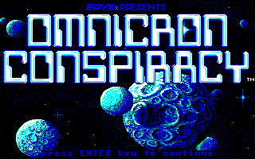
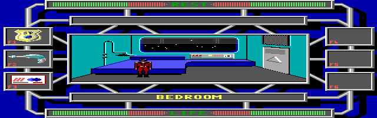
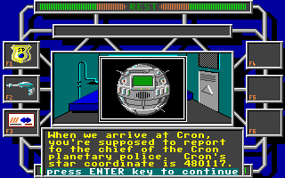
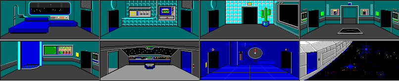
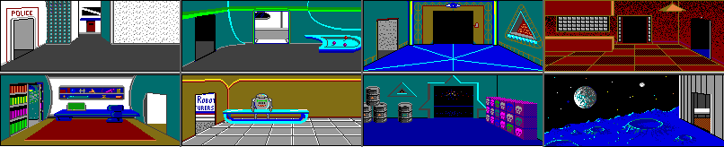
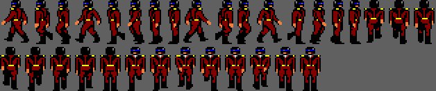
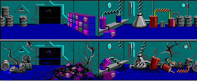

# The Omnicron Conspiracy

*Omnicron Conspiracy* (First Star Software, 1989; Epyx published it in North America, Mirrorsoft
in Europe) sends Captain Ace Powers of the Star Police after a drug ring and a missing
operative, with P.A.L., his ship's droid, for company. The credits, in the game itself: design
and programming by Jesse Taylor, initial game design by Jim Nangano, script by Sheryl Knowles,
original story by Subway Software.



## What's in the folder

| File | What it is |
|---|---|
| `OMNICRON.EXE` | The loader, 11,261 bytes, packed with EXEPACK: it runs the game, and stays in memory with the game's graphics code |
| `SCODE.EXE` | The game, 111,887 bytes |
| `PLAY.EXE` | The music player, 16,658 bytes, built with Microsoft C: the theme over the title |
| `OMNICRN9.MUS`, `OMNICRN9.SND` | The theme and its timbre bank, for an AdLib |
| `SOUNDS.DNL`, `THEME.DNL` | Sounds; the game loads the first as it starts |
| `TITLEEGA.CMP`, `TITLECGA.CMP` | The title picture: the first for the EGA and the MCGA, the second for the CGA |
| `CONTROL1.CMP`, `CONTROL7.CMP` | The control panel around the room: the first for the EGA and the MCGA, the second for the CGA |
| `ALLROOM0.DAT` to `ALLROOM3.DAT`, `OFFSETS0.DAT` to `OFFSETS3.DAT` | The rooms' pictures, 212 of them in four sets, each set with where each picture starts |
| `DIALOG.BUE` | Not the dialog: the picture of the box it's shown in |
| `AWARDS.PAK` | A full screen: the awards |
| `FCONTROL.PAK`, `PAKDATA\*.PAK` | Sprites, 160 files of them in `PAKDATA`, named for what they show: Ace (`ALLACE3`), P.A.L. (`PAL`, `PALZM`), doors, missiles, the people of Cron |
| `OMNICRON.COM` | Not the game's: 397 bytes, dated 2009, added for DOSBox (see below) |

The game's files are all dated December 25, 1996. The manual says to copy both disks to a
hard disk, `PAKDATA` with them, and run `OMNICRON`.

## The loader and the game

`OMNICRON.EXE` has its say if there's less than 512 KB, or if `SCODE.EXE` isn't there
("Please ensure that 'disk 1' is in drive 'A'"), and otherwise runs it with DOS's function 4Bh, the call that runs one program
from another and comes back when it ends. It doesn't exit itself. Its strings ("Not a Valid
splatter call for NON-RL encoded buffers", "Internal splatter list OVERFLOW. You splat list IS
TO LARGE!") belong to a graphics library, and the library stays with it: it sets interrupt
vectors 62h and 64h to its own code before it runs the game, and its code is what sets up the
EGA and the MCGA.

The game, in turn, runs `PLAY.EXE` for the title: it plays `OMNICRN9.MUS` on the AdLib's port,
388h, and polls DOS for Enter, function 0Bh then 08h. At Enter it puts the timer back, closes
its files, and exits to the game.

This was the first time a game ran a program that way in Excavate, and three things had to be
added for it:

- **Function 4Bh** loads the program in the memory the caller left free, gives it its own PSP
  with the caller as its parent, and on its exit frees what it had, puts back the vectors it was
  given in its PSP, and returns to the caller as if the call had just finished, with its exit
  code for function 4Dh.
- **A program's handles are its own.** `PLAY.EXE`'s C runtime closes every handle on its way
  out, 0 to 4 among them; in DOS that touches only the player's copy of the table, and the
  game's standard input and output stay open. The handles a program opens are closed when it
  ends, and the ones it was given aren't.
- **DOS reads the keyboard through INT 16h.** By the time the music plays, the game has its
  own INT 09h and INT 16h: keys go to the game and never reach the BIOS's buffer. DOS's console
  calls INT 16h for a key, as its CON driver always did, so the game's INT 16h answers the
  music player's question. DOSBox's DOS reads the BIOS's buffer instead, which is presumably
  why `OMNICRON.COM` exists: it hooks INT 21h to send functions 0Bh and 08h to INT 16h, then
  runs `OMNICRON.EXE`. eXoDOS's launcher types `omnicron`, and DOS runs a .COM before an .EXE
  of the same name. Excavate runs `OMNICRON.EXE`, and doesn't need it.

## The display

The game asks for the display: "(0). Quit (1). CGA (2). Tandy 1000 (3). EGA (4). MCGA (5).
Hercules", and suggests one. On Excavate's VGA it suggests the MCGA. It finds the display with
a series of tests of the kind Richard Wilton's book on PC video gives. When the VGA's BIOS
answers function 1Ah, the display combination, the game takes its answer and skips the tests
that are left, the EGA's among them. So the EGA is never marked as found, and choosing it says
"You do not have an EGA card or the monitor does not support EGA". It would on any VGA. Enter
takes the EGA anyway.

- **The MCGA** is mode 13h. The loader loads the game's 16 colors into the DAC 16 times over,
  each color filling a block of 16 entries, so only a byte's top four bits choose its color.
- **The EGA** is mode 0Eh, 640 by 200, each of the game's pixels two dots wide. The loader
  selects page 1 with INT 10h function 05h and draws there, at A000:4000. In page 0 it writes
  4,096 bytes of patterns: in write mode 2, three of each byte's four pairs of dots, in every
  combination of the 16 colors. Excavate's BIOS only selected pages in the text modes, so
  the EGA showed page 0 and its patterns. It now selects them in the EGA's graphics modes
  too.
- **The CGA** is mode 04h, with its own title and control panel, in the second palette:
  cyan, magenta and light gray.

On the EGA, Ace walks from the bedroom through the galley and the living room to the
transporter room, and on the CGA to the living room, drawn as on the MCGA. The Tandy 1000 and
the Hercules aren't tried: Excavate's VGA has neither.

## The sound

The music is the title's alone: `PLAY.EXE` plays the theme on the AdLib, and it plays in
Excavate. Everything in the game itself is on the PC speaker, through the
timer's counter 2. `SOUNDS.DNL` holds the effects as notes, and a table in `SCODE.EXE` turns
each note into the counter's divisor, from 18,243, a C two octaves below middle C at 65.4 Hz,
up by semitones. The effects keep to the low end of it: Ace's laser is a buzz of notes between
about 65 and 300 Hz, and his footsteps are clicks, eight or so a second. Recorded from
Excavate, both come out at those pitches. The manual has S turn the sound off and on.



## The start

After the title and the copyright, Ace is in his bedroom on the ship, and P.A.L. floats in with
H.Q.'s orders in three messages: "Yo, Boss. H.Q. says go to the planet Cron, stat. One of our
operatives has gone silent while tracking a drug ring there." The second gives where Cron is.



The manual's mission briefing gives the same: "Cron's star co-ordinates are 480117." The
manual also says disk 1 must be in drive A for the game to run, but nothing checks the disks:
the game's one INT 13h is a disk reset after it puts the timer back.

Excavate's test plays it this far, on the MCGA and the EGA: the loader, the display, the
music player handing back, P.A.L.'s three messages, and the bedroom.

## The game's files

`tools/firststar/omnicron_files.py` reads them (see [the tools](../tools/README.md)): it lists
the rooms and the text, and writes every picture as a PNG file.

### The packing

The rooms' pictures, the sprites and `AWARDS.PAK` are packed the same way, in two layers.
`SCODE.EXE` unpacks them itself, with a routine of about a hundred instructions.

- **Byte pairs.** A packed file starts with its size unpacked, then has blocks. Each block lists
  pairs: a byte that stands for two others, and those two. The block's bytes follow, and each
  that stands for a pair becomes its two, which can stand for pairs in turn. A byte stands for
  a pair only if that pair comes before the one that made it in the list, so the same byte can
  mean different pairs in different places. It's much the scheme Philip Gage published as byte
  pair encoding in *The C Users Journal* in 1994, five years later.
- **Runs.** What that gives has runs: BFh and a count is that many zeros, and CFh, a count and
  a byte is that many of the byte.

The CMP files, the title and the control panel, are packed another way, row by row: a table of
where each row starts, and in each row runs of a 2-byte word repeated or words given one by one.
That unpacking is the loader's, in its graphics library.

### The pictures

All of them are 16 colors, two pixels to a byte. The CGA's title and control panel are the
exception, with four pixels to a byte. A picture starts with 32 bytes that give its width and
height.

A room's picture is 200 by 81 pixels, the window in the middle of the control panel.
`ALLROOM0.DAT` has the 8 rooms of Ace's ship, the Falcon:



The other three sets are Cron and what's around it: in `ALLROOM1.DAT`, the Sarbai base, a
station of orange hallways where Quattro keeps his death ray, then the Blackstar, the freighter
Ace finds attacked, and the police station, the Mentant Temple, the library and the Green Tattoo
bar; the city's streets and shops, the hotel and the Mind Zi Tavern in
`ALLROOM2.DAT`; and in `ALLROOM3.DAT`, the G.U.N. factory and its offices, the labs, the secret
drug lab and the asteroid.



A sprite file has frames, each with its own size. Ace's `ALLACE3.PAK` has 114: walking,
standing, shooting, breaking up into sparks, and one of him as a giant purple artichoke. As the game loads
a sprite, it swaps the file's see-through color, given in its header, with color 0, which is
see-through when it draws. A character can also have one more color changed: Ace's
olive-drab helmet and boots are black on the screen.



The pictures are drawn here in the game's own colors, the 16 its loader gives the MCGA. They
aren't the EGA's: the dark colors are darker, the bright ones purer, the brown is olive and the
light red is orange.

### The rooms

The rooms themselves are records in `SCODE.EXE`'s data. Each has a name, a picture and its set,
three doors, and the room each door leads to. There are 252 of them, more than the pictures,
because some pictures serve several rooms: the five hallways of the police station are one
picture, and so are the hotel's four bedrooms. The clerk gives Ace number 4, "at the end of the
hallway". A room wider than the screen is
two or more pictures side by side, each its own record, with a door between them.

Two pictures have no room. They're the secret drug lab again, wrecked, so the game presumably
swaps them in after the lab blows up:



### The things

Everything Ace can touch is a record too, laid out like a room's: a name, the first thing it
holds, what holds it (a room, another thing, or Ace), and the next thing in the same place. So
the data says where everything is as the game starts, down to what's in each drawer: the card
key and DexBoost capsule in Ace's night stand, a hamburger in the Falcon's Preserve-O-Matic, an
antimatter grenade on Fred the Clip, Stardust in Galloway's night stand. There are card keys in
three places besides Ace's bedroom: on the hotel's manager, on a thug in the Mind Zi Tavern, and
on Rand Ungar's couch, with brochures. Quattro waits in the Sarbai base's lab with his death ray.

### The text

`SCODE.EXE` also has all the text: what people say, what things look like when Ace looks at
them, the letters, memos and logs he finds, the menus, and the credits. A message that follows
another after an Enter is marked as one. Some of what's there:

- An ad for Epyx's *The Legend of Blacksilver*, among lines that read like TV, presumably for
  the OmniMon, which "allows you to view programming from many different worlds": "Ready for a
  spine-tingling swords and sorcery adventure? Try The Legend of Blacksilver, from Epyx. Coming
  soon."
- The Blackstar's log, which stops at "Wait! Those markings! Sarbai!! What are they doing
  .....", and its manifest, with Dr. L. Quattro on the passenger list.
- Quattro's victory speech, in two versions. One begins "You're too late, Captain Ace Powers",
  the other "At last, my death ray is fully operational", and both get to "DEAD wrong. HA HA HA
  HA HA HA...."
- The real estate agency's listings, each with its star coordinate. The asteroid in the Cron
  system, 356972, is sold. A memo gives the Sarbai base's: "asteroid D-892 coordinate 563381".
  The game keeps the coordinates it knows as one string of six-digit numbers, these two and
  Cron's 480117 among them (see [the coordinates](#the-coordinates)).
- The rejuvenation booth. "You were lucky this time, Boss. Please be more careful. This
  procedure is very unpredictable." When the luck runs out, Ace's genetic structure has been
  permanently altered: "But don't feel too bad. I hear the girls just can't keep their hands off
  of a giant purple artichoke in a Star Police uniform." That's the artichoke among his frames.

## Playing it

Played in Excavate, on the MCGA, from the bedroom to the Blackstar. None of it needed a change
to Excavate.

### Getting around

Ace walks with the arrow keys and goes through a door by walking into it: it opens as he
touches it, and he's through on the next step. What he touches is named on the bar above the
room, and Return then brings up a menu for it: examine, use, search, converse, take.

The game decides what Ace touches with boxes. Each thing in a room has one, and it counts only
in the direction Ace is facing: walking up, he touches what's just above him, and walking left,
what's just to his left. That's all there is to the first puzzle, sitting down to fly. The pilot's
chair on the bridge is two things, its back and its front, and walking up to it only ever finds
its back: "You must be at the front of the chair in order to sit down." The front's box is
behind the chair, and the only way to it is the narrow gap between the chair and the console,
walking up and then turning left. Sitting brings up the ship's menu: set star course, jump to
hyperspace, check fuel supply.

### To Cron and back

1. **The bridge.** The course is a six-digit coordinate, typed in. The Falcon starts at 910934,
   and Cron is 480117, from the manual and from P.A.L.
2. **The transporter room.** Walking onto the grid and using it beams Ace down to the police
   station on Cron, where Lt. Lazlov Drek meets him ("My friends call me Laz, but you can call
   me Lt. Drek") and walks him to the dynalift: "OK, Hero. Just take the dynalift to the top
   floor. The Chief's expecting you."
3. **The dynalift.** Its panel lists the floors: 1, transporter; 2, payroll; 3, ComCenter; 4,
   archives; 5, supply; 6, the Chief.
4. **The receptionist.** The game's text has her ask for Ace's ALSWELL: "Captain Powers, you'll
   have to leave your weapon on the table before you can enter the Chief's office." Ace put it
   on her desk on the way in, and searching the desk on the way out gave it back.
5. **The Chief.** He repeats the manual's briefing and adds where the Blackstar was found:
   "floating dead in space at star coordinate 711509."
6. **Back to the Falcon**, by the same transporter, and to 711509. The Falcon's hatch, in its
   airlock, stays shut, and its script shows why: it opens only once a card key has been used
   on it. The key is in the night stand in Ace's bedroom, with a DexBoost capsule. Using it on
   the hatch takes Ace across to the Blackstar.
7. **The Blackstar.** Its crew are dead in the hallways and the cockpit ("He's been fricasseed
   by a blaster"), and the cockpit's panel offers what the controls have left: VIEW SHIPS LOG
   and VIEW SHIPS MANIFEST.
8. **The cargo bay.** Agent 786's droid starts talking as soon as Ace reaches it: "S.P.
   Operative 786 personal droid reporting, sir." Sarbai assassin droids attacked three days ago
   and killed everyone; the agent had traced Stardust to Cron, bound for the planet Sheem as
   medical supplies; the two passengers were Dr. Quattro, who has vanished, and Carthon Paucert,
   who's "over there". Paucert is the body on the floor, "toasted by blaster fire", with nothing
   on him.

### The coordinates

The coordinates are kept as one string in the data: 356972, 927325, 480117, 563381, 711509,
910934 and 910934. The last two are where the Falcon is and where it's headed. Setting a
course changes the last, and arriving changes the other: at the Blackstar both are 711509.

The game also keeps where the Falcon is as a number, the coordinate's place in the string, and
a table of the transporter rooms the first four lead to:

| Coordinate | Where | The Falcon's transporter leads to |
|---|---|---|
| 356972 | The small asteroid the real estate agency lists as sold | A lab |
| 927325 | Delphi, Cron's moon | The science complex's transporter room |
| 480117 | Cron | The police station's transporter room |
| 563381 | The Sarbai base, on asteroid D-892 | The base's transporter room |
| 711509 | Where the Blackstar drifts | Nowhere: "We are not in orbit around a planet." |
| 910934 | Where the Falcon starts | Nowhere |

A planet's own transporter works only while the Falcon is in orbit above it: "The Falcon is
too far away." G.U.N.'s cargo transporter, in its factory on Cron, goes to Delphi and back,
and moves the Falcon's place with it.

## Where the play stops

The play stops at the Blackstar. By then it had gone through the loader, every display mode
Excavate has, both kinds of sound and a dozen rooms on two ships and a planet, without
needing anything more of Excavate, and what's past it is the same engine in more rooms. Playing
on is slow work: Ace has to be placed to the pixel, and the menus are slow to answer. The rest
of the game is read from its scripts instead.

## The scripts

What everything in the game does is written in a small bytecode, in `SCODE.EXE`'s data, and
run by an interpreter of 57 opcodes in its code. The tool disassembles all of it:

```
python tools/firststar/omnicron_files.py <the game's folder> scripts [<name>]
```

### The language

A thing's record points at two scripts. One runs every frame while the thing is in the room
Ace is in: a door opening as he comes near. The other runs when Ace touches the thing and
presses Return, or uses it from a pocket, and it usually starts with the thing's menu, its
examine text and where USE goes. The characters who move and talk by themselves, 63 of them,
have a third, their behavior, listed in a table of their own: P.A.L., Drek, the guards, the
Ungars, Quattro. A behavior runs a step a frame. Walking to a place or through a door takes
as many frames as the walk does, and `count` and `loop` make it wait.

The opcodes come in a handful of kinds:

- **Flow:** `goto`; comparisons of a word or a byte with a number (`compare`, `test`), which
  leave flags for `if.equal`, `if.not.equal`, `if.less` and `if.not.less`; `switch`, which picks
  a place by a word that other scripts set; `if.carried`, `if.here` and `if.touching`, which test
  where things are.
- **State:** `set`, `add` and `copy`, for words and bytes. Their target is any address in the
  data, and very often it's an operand of another script: a card key unlocks a door by setting
  the word its `switch` picks by, and Quattro's whole ending turns on one such word.
- **Saying:** `say`, a message in the box; `talk`, a portrait and a conversation, from the
  second data segment where the face-to-face text is kept, a page per Enter; `menu`, a title and
  items, and a place for each choice.
- **Moving things:** `move`, `move.to`, `give.to` and `remove`, which take a thing out of one
  holder's list and put it at the head of another's: a room's, a thing's, or Ace's pockets.
  `buy` takes credits off the MetaCard and gives Ace a thing, or goes somewhere else if he can't
  pay.
- **Moving characters:** walking to a thing, to a place, or through a door; animations.
- **Native:** a call into `SCODE.EXE`'s own code, for what the language can't do: the
  dynalift's floors, the transporters, the explosions.

A script's comments and names are gone, but its text isn't: the disassembly prints each
message, each menu's items, and each thing's name where the script refers to it, so it reads
almost as the designers wrote it.

### How the game is won

The awards ceremony the Chief throws is where the game decides, and it checks two things. If
Quattro is alive, the ceremony cuts away to his asteroid, "Meanwhile, on a small asteroid
somewhere near the planet Cron .......", where his death ray fires on Cron and he gloats: "It
worked, it worked! Victory is mine." If he's dead but the Sarbai droids are still programmed,
one of them is at the ceremony: "This is for destroying our base on asteroid D-892. Eat plasma,
Powers." Only with both done: "Congratulations, you have successfully completed the Omnicron
Conspiracy. The final victory is yours."

From the scripts, the way there is:

1. **Blow up the drug lab.** A frug on Cron's streets sells a thermal detonator for 50
   credits, but not to a man wearing a Star Police badge, as the manual warns: "The Star Police
   badge is often more trouble than its worth." Using the detonator sets a timer, and when it
   goes off, the game checks where the detonator is. If it's in the secret drug lab, reached
   through the Mentant Temple, "Booooooooooommmmmm": the lab is wrecked, presumably where the
   two pictures no room uses come in, and the Chief's script moves on.
2. **Burn out the Sarbai droids.** The master computer that programs them is in the tunnels
   behind the Green Tattoo bar's store room, behind a door that only the card key from Rand
   Ungar's couch opens. With the
   Marry Banillo album from the record store in it ("More boring songs about people in love"),
   PROGRAM DROIDS overloads it: "!!SYSTEM OVERLOAD!! DATA BANKS ARE BURNING OUT". The Iron
   Munchkin album only reprograms them: "Droids set to blow the guts out of anything and
   everything that gets within blaster range."
3. **Kill Quattro.** He's in the lab of the Sarbai base, at 563381, with his death ray. The
   ALSWELL has two settings, stun and kill, and only killing him sets what the ceremony checks.
   There's a time limit: once a counter the game's clock advances reaches 4, with Quattro alive
   and Ace not in that lab, the cutaway to the asteroid starts on its own.
4. **Report to the Chief.** With the lab gone, he says "Congratulations, Captain Powers. Your
   mission appears to have been a complete success. As a token of our gratitude we have arranged
   for a little awards ceremony in your honor."

On the way, the scripts show who's who. Cort Ungar welcomes Ace and mourns "the death of Dr.
Quattro", one of his best men, and recommends his sister Rand, who "helps Dad administer his
droid business". Rand is behind the Sarbai base: once Ace has burned out the droids or killed
Quattro, she drops the act: "I'm very
disappointed in you. Attacking my base is a sure way to piss me off." Dr. Lester Galloway is one of the "renegade
Mentants" behind the drug lab, and waits for Ace after
it blows: "You know too much, so now you must die." And Rand's attempt to seduce Ace is cut
short by the game itself: "We sincerely apologize for the inconvenience, but this 'is' a family
game."

This is read from the scripts and the code they call, and hasn't been played: the order the
steps can be done in, and what gets Ace into each place, is still for the scripts of the rest
of the rooms to show.
