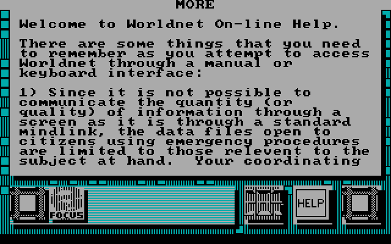
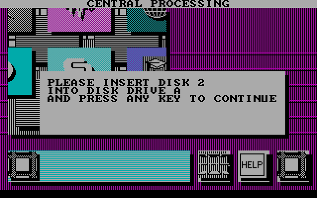
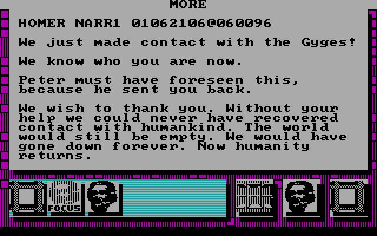
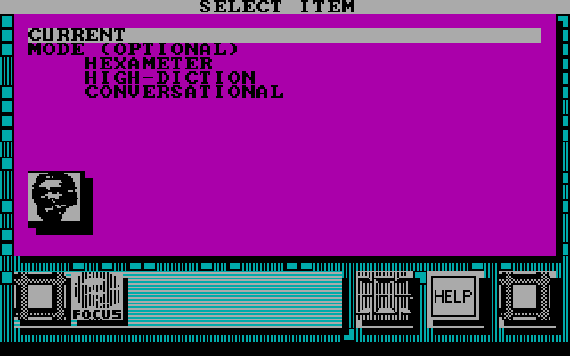
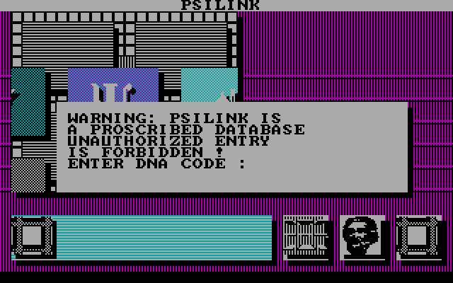

# Portal

*Portal: A Computer Novel* (Activision, 1986), written by Rob Swigart, programmed by Nexa
Corporation. It came on three 5.25-inch disks, for the IBM PC with a CGA, the PCjr and the
Tandy 1000.


## What's on the disks

The images are 368,640 bytes each: 40 cylinders, 2 sides, 9 sectors of 512 bytes, the 360K
format of DOS 2.0.

**Disk 1** is a DOS disk, but not a bootable one. Its root directory holds:

| File | Size | What it is |
|---|---|---|
| `IBMBIO.COM` | 2,047 | Hidden and system, and empty: nothing but E5h, a fresh format's filler |
| `IBMDOS.COM` | 35,321 | The same |
| `PORTAL.EXE` | 89,627 | The game |
| `XEMAG.SYS` | 4,607 | Hidden, system and read-only; see below |

The two DOS files are placeholders. The disk reserved the room for DOS's system files, so a
buyer could run `SYS A:` and make it boot; Portal never shipped with DOS on it. The way to play
was to boot your own DOS, put disk 1 in and type `PORTAL`.

The deleted entries look like the developers' scratch files, left from the disk they mastered
on. DOS deletes a file by overwriting the first letter of its name, so that letter is lost:
`?RASER.EXE`, `?EST1.BAS`, `?AMPLEV2.C` and `?AMPLEV2.ASM`, `?OMPILV2.BAS`, `?RFMARK.BAS`,
`?AINV2.BAS`, `?WSECTOR.EXE`, from 1985 and 1986. Disk 3 has a deleted `?ACE.LST` of 335,928
bytes, dated October 1986: by its name and size, an assembler's listing.

**Disks 2 and 3** have empty root directories. The game reads its data from them by sector,
through the BIOS, not as files.

## The protection

`XEMAG.SYS` (GAMEX backward) starts at cluster 77, which is cylinder 9, head 0, sector 1, and
covers that whole track. Its contents are a format's raw bytes: F6h filler, 4Eh gaps, and F5h,
which a format command writes as the A1h sync marks that start a sector. It's a hidden file so
that DOS never puts anything on that track, and so that copying the disk's files leaves it.

On the original disk the track was formatted with more than nine sectors. The game checks for
them in a far procedure at the start of `PORTAL.EXE`'s image:

1. Verify (INT 13h function 04h) cylinder 0, sector 1.
2. Verify cylinder 9, head 0, sectors 16 down to 1. A standard track has only nine, so on a
   copy the verify of sector 16 fails, and the procedure returns 0Ah.
3. Read sector 9 of that track. The first 512 bytes of the program's image are zeros, a buffer
   for it: the procedure's `mov si, 0; mov es, si` is relocated by DOS to the program's own
   segment.
4. Hash five bytes at 18Bh of the sector (`CCCCC` on the disk) into a word, starting from
   ABCDh, and return it.

The program's entry then does this:

```
call  0020:0000      ; the protection: AX is the hash
sub   ax, 859Ch
int   10h            ; the video mode call
mov   dx, 3D9h
mov   al, 20h        ; palette 1, no intensity, black background
out   dx, al
```

There's no test of the answer. With the right disk, the hash is 85A0h, and AX becomes 0004h:
set mode 4, 320 by 200 in four colors. Without it, AX is 0Ah less 859Ch, 7A6Eh, a function the
BIOS ignores, and the game carries on drawing into a screen that never left text mode.

A plain image of the disk kept sector 9's data, key and all, but not sectors 10 to 16, whose
contents the game never reads. Excavate puts them back: the player knows that disk 1's cylinder
9, head 0 had sectors to 16, and the drive finds them. The game's program runs unchanged.

## How eXoDOS runs it

The eXoDOS copy has the three disks as `DISK1.DAT` to `DISK3.DAT`, and `PORTAL.DAT`, which is
`PORTAL.EXE` with 41 bytes changed, run by `PORTAL.COM`, a 437-byte loader written in 1996 by
Mok. Comparing the two programs shows what Portal needs from the machine:

- The protection's two verifies are replaced with NOPs, and its jump on success made a jump
  whatever the result.
- The protection's read, and each of the game's six `INT 13h` calls, are changed to `INT 83h`,
  which the loader answers: reset, read and write, by cylinder, head and sector, in the `.DAT`
  files.
- The prompt for another disk is replaced with a call to the loader's own function AAh, which
  swaps disks without asking.
- The `out 3D9h` is replaced with the BIOS's palette call (function 0Bh, palette 1). That keeps
  the BIOS's intensity bit, which the original clears: so eXoDOS shows bright cyan, magenta and
  white where the original showed cyan, magenta and light gray.

Excavate uses none of it. It runs `PORTAL.EXE` from disk 1 as DOS would, gives it a drive and a
BIOS that answer its own INT 13h calls, and answers the game's prompts for another disk from
outside the program, as below.

## What it asks of the PC

- **The disk, by sector.** The game reads and writes through INT 13h a sector at a time, from
  drive A:. Its data on disk 1 uses eight sectors of each track, never the ninth, as DOS 1.1's
  320K disks had them: cylinder 36 reads sectors 2 to 8, then the other side's 1 to 8. A read
  that fails with 80h (no disk) or a write with 03h (write-protected) each shows a message of
  its own. What it writes goes, in Excavate, to a copy of the disk in the save folder.
- **The BIOS's font.** The game draws its own text in graphics mode, from a glyph table of its
  own and, for the characters beyond it, from F000:FA6Eh: where IBM's BIOS keeps the first 128
  characters of its 8 by 8 font. A BIOS without the font there leaves every prompt blank.
- **The keyboard, through the BIOS, with interrupts off.** It waits for a key with `cli`, then
  INT 16h function 01h in a loop. That works on a PC only because IBM's BIOS turns interrupts on
  inside INT 16h. Before each prompt it empties the BIOS's keyboard buffer by setting its tail to
  its head, so a key typed while it's still drawing is lost.
- **The speaker**, through counter 2 of the timer, for its beeps. It sets only the count
  (`out 42h` twice), relying on the BIOS to have put the counter in its square-wave mode, and
  times the beep with `loop` delays.
- **The joystick**, through port 201h, if you say you have one at the start: see below.
- **An 8088's speed.** Its pauses, such as how long a panel stays up, are a `loop` run a
  number of times over: 260 times the count it's given, up to 2,500. A taken `loop` is about 17
  of the 8088's clocks, so at 4.77 MHz the longest pause is some 2.3 seconds, and on a faster
  machine it's shorter by as much as the machine is faster. Excavate runs it at 300
  instructions a millisecond, about an IBM PC's pace. (eXoDOS has it at 600, twice that.)
- **The model byte** at F000:FFFEh: FDh, a PCjr, is noted for later.
- **`INT 1Ah`** function 00h, the tick count, as a random number.

## The controls

The manual, written for every version, says to move around "using your pointing device
(joystick, mouse, etc.)". The PC version has no mouse: nothing in `PORTAL.EXE` calls the mouse
driver's INT 33h, and it never draws a pointer. Wherever you are, one choice is highlighted, its
colors reversed, and its name is shown across the top of the screen.

Every choice goes through one routine that answers with a key's scan code, from the keyboard
or from the joystick:

- **From the keyboard**, it empties the BIOS's buffer and waits for a key: the arrows, 48h,
  4Bh, 4Dh and 50h, move the highlight, and Space, 39h, chooses. Esc ends the game there and
  then, back in text mode at the DOS prompt.
- **From the joystick**, chosen at the start, it ignores the keyboard. It times the stick's
  two axes through port 201h against a center it keeps, and when one axis is off center by at
  least five counts more than the other, answers with the arrow for that way. Either button
  answers Space. On a PCjr (model byte FDh) it weighs the two axes a little differently.

The answer to the joystick question is taken once and kept. Nothing checks that a stick is
there: with none, the port's timers never run out, every reading is the same as the center
read at the start, and the game waits for a move that never comes, the keyboard ignored.

So the joystick is four arrows and Space, with no position of its own. In Excavate the mouse
can be that joystick: the game port always has a stick for Portal, and once the mouse is
captured, a short move of it (a twentieth of the picture) pushes the stick all the way that way,
and its buttons are the stick's. The game may be drawing for a second or more before it reads
the stick again, so each push and click is held until it has, then let go: one move of the
mouse is one step of the highlight. The highlight moves from
choice to choice in an order the game sets for each screen. On the map of Worldnet's dataspaces
it's a grid of three rows of four, Up and Down a row and Left and Right a place; inside a
dataspace, Up and Down go through its choices, down to the row of buttons along the bottom.

That row is four choices, one highlight each, and Left and Right go along it. Their names, in
the table the game keeps of every choice's name, aren't what's printed on them:

| Highlighted | Its name across the top |
|---|---|
| The square at the left, with FOCUS and the bar beside it | EXIT THIS LEVEL |
| The four arrows | DATA STORAGE |
| HELP | HOMER MESSAGES |
| The square at the right | EXIT TO INTERFACE |

There's no choice named HELP: the button is Homer's, Worldnet's guide, and choosing it brings
up Worldnet's on-line help. So it's reached with Down to the bottom row, then Right twice.



## Asking for a disk

Disk 1 holds the program, the login and Central Processing. The story's later levels are on the
other two. The game keeps the level at 213h of its state: 1 is on disk 1, 2 and 3 on disk 2, and
4 and 5 on disk 3. When the eight entries it keeps for a level are all marked done (FEh), the
level goes up, and a flag tells the next dataspace you go into to check the disk. It reads a
sector that tells the disks apart, on cylinder 34 for levels 2 and 3 and cylinder 36 for 4 and
5, and if it isn't the level's disk, it asks:



It waits for a key, reads the sector again, and asks again until the right disk is in. That's
the only check: put the wrong disk in during a level and the game reads it as if it were the
right one, and draws garbage.

A second prompt asks for disk 1, whatever the level, before restoring a saved position, which
is kept on disk 1. After that comes the check for the level's disk.

Both prompts wait in the keyboard routine, not the one that reads the stick. So with a joystick
chosen, the prompts still need a key from the keyboard.

Excavate answers both for you, and the game's program runs unchanged. The player knows where
the two prompts wait for a key. When the game waits there, Excavate reads which disk the prompt
names from the game's memory (the digit it shows), puts that disk in the drive and presses
Space. The prompt comes up and goes away again, and the status line says which disk went in.
Ctrl+F1 to Ctrl+F3 still put a disk in by hand. This is what Mok's loader does from inside the
game, with the prompt replaced by a call to the loader; Excavate does it from outside, as
someone sitting at the machine would.

## The story

*Portal* has no puzzles and no way to lose. Its story is told in pieces, files and records in
Worldnet's dataspaces and messages from Homer, and reading some pieces unlocks others. A
[walkthrough](portal-walkthrough.md) of one path through them is generated from what follows.

### What the game keeps

The story has five levels. The game's state, in the data segment at 584h, holds the level at
213h, and from 72Ch a flag byte for each of the level's items, up to 8Ch of them:

- The low nibble is the item's dataspace, numbered as the map's places are, left to right and
  top to bottom: 0 Med10, 1 PsiLink, 2 SciTech, 3 History, 4 Military, 5 LifeSupport,
  6 Geographical, 7 Wasatch, 8 Psychological, 9 Central Processing, 10 Edmod, 11 Homer. 12 is
  Interface, Homer's side of the conversation, which has no place on the map: its items come
  through Homer.
- Bit 20h is set while the item is locked, and 10h while it's unread.

Level 1's flags are the program's own starting values. Each later level's are read from its
disk as the level starts.

### Where the pieces are

The game reads its data by byte address, through its own routine over INT 13h. An address is a
place in a run of 512-byte sectors, eight to a track as the game's data uses them, side 0 then
side 1 of each cylinder. That's how the disks tell themselves apart: the byte at 44FFFh holds
`1` on disk 1 and `2` on disk 2, and the one at 4FFFFh holds `3` on disk 3.

Each level has a table of 1C20h bytes: at 45000h of disk 1 for level 1, at 46C20h and 45000h of
disk 2 for levels 2 and 3, and at 4BC20h and 4A000h of disk 3 for 4 and 5. It has 5 bytes for each item, a 3-byte address and a 2-byte
length, and from 5DCh on, the offsets of the titles its lists show. At an item's address are:

| Bytes | What |
|---|---|
| 8 | Its prerequisites: the items that must be read before it unlocks (FFh for none) |
| 8 | Its successors: the items it leads to |
| 4 | Lengths |
| The rest | Its text, in ASCII with the high bit set on the last character of each word or line and FFh at the end, then any picture |

### The rule

An item unlocks when each of its prerequisites has been read. Numbers above a limit for the
level (38h, 4Ch, 66h, 76h and 6Eh) aren't items there, and count as read, except, in level 5,
85h and up. When an item is read,
the game puts its successors on a list of up to 16 that it's watching, reads their records,
and unlocks each one that's ready.

A level ends with an item that has FEh among its successors. Once that's read, the level number
goes up, and the next dataspace you go into asks for the level's disk and loads its flags.
Level 5 has no such item: it ends with Homer's goodbye, unlocked by History's last two pages,
the decades 2090 and 2100. It comes up straight after the last of them.



Everything else is reading for its own sake. Each level also has code of its own that unlocks
extras: in level 1, Homer's fourth message opens SciTech's eight articles on old interfaces. Of
level 1's items, 47 are on the way to its end.

### Read means to the end

In Central Processing and Homer's dataspace, an item counts as read only once it's been paged to
its end. The game notes reaching the last page, when the title changes to NO MORE, at 218h, and
checks it when it comes to mark the item read. (The walkthrough pages everything to the end, which works
everywhere.)

### Homer

At the start of levels 1, 2 and 4, Homer's first message comes from a menu of kinds of story:
history, military conflict, comedy, tragedy, romance, a gender, and a manner (hexameter, high
diction or conversational). The one that brings his message is CURRENT, near the bottom. The
others weren't tried; among the program's texts is "ALL OPTIONS INACTIVE EXCEPT CURRENT". Levels
3 and 5 start with a message the game shows on its own.



The HOMER MESSAGES button, when Homer has nothing new, shows one of his idle lines: "Do you trust
me?", "I am frightened." It's not a question that needs answering.

### The DNA code

PsiLink and Military warn that they're proscribed and demand a DNA code. The texts are full of
DNA numbers to try. None is needed: the prompt waits for any key, and then the game looks at
what's unlocked there. With nothing, it says "ENTRY DENIED!" and sends you back. With something,
it says "BREAK: DNA ENCODE OVERRIDE? REF. HOMER DATABASE." and lets you in.



### Finding the path

How this was worked out, a step at a time:

1. **The level number.** The disk prompt's code showed the level at 213h. The one place that
   adds to it is at the end of the routine that marks an item read, which checks the record
   just shown for FEh among its successors.
2. **The records.** That routine loads records by item number, through the 5-byte table. The
   table's loader gave its disk address, and the disk-label bytes confirmed how addresses map
   to sectors. With that, every level's table and records could be read straight from the
   images.
3. **The flags.** The low nibbles matched the program's list of dataspace names, in the same
   order as the map. Bits 20h and 10h were confirmed by watching them change in play.
4. **The path.** Starting from each level's end and following prerequisites back gives the
   items that must be read. Ordering them so that each comes after its prerequisites gives the
   [walkthrough](portal-walkthrough.md).
5. **Playing it.** A reader in Excavate's tests plays the game through its keys. It reads the
   flags from memory to know what's unlocked, and the number of the name across the top of the
   screen, at 13Ch in the game's data, to know what's highlighted. That's how the rules for
   reading were found: paging to the end, Homer's CURRENT, the DNA code, and the pieces that
   come up by themselves. It plays from the login to Homer's goodbye in about two minutes:

   ```
   EXCAVATE_PLAYTHROUGH=1 dotnet test -c Release --filter Its_story_plays_through_to_homers_goodbye
   ```

## The composite picture

Much of the artwork is made of one-pixel vertical stripes: cyan and magenta alternating across
the background, gray and black across the panels. On an RGB monitor they're stripes. On a
composite monitor, or a television, four of the CGA's 640 dots across make one cycle of the
color carrier, so a pattern repeating every four dots is seen as a color of its own: the
stripes become solid purples, browns, greens and blues.

| RGB | Composite |
|---|---|
|  |  |

Ctrl+F11 switches between them while playing, and `--composite` starts with the composite
picture. Excavate's composite decoding is reenigne's model of the CGA's output, as DOSBox
Staging has it.
