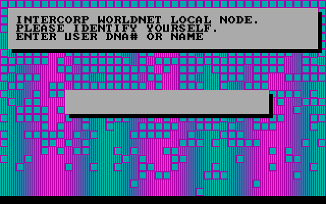
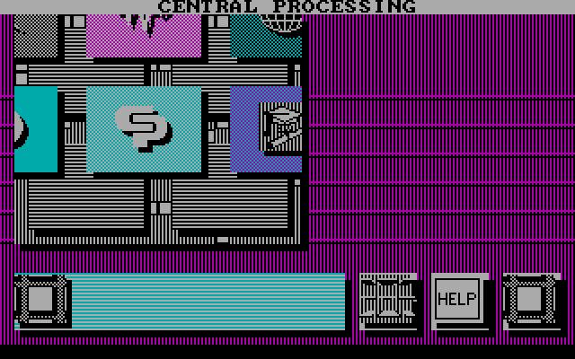
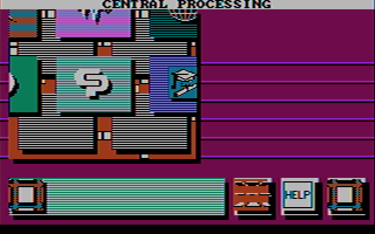

# Portal

*Portal: A Computer Novel* (Activision, 1986), written by Rob Swigart, programmed by Nexa
Corporation. It came on three 5.25-inch disks, for the IBM PC with a CGA, the PCjr and the
Tandy 1000.



## What's on the disks

The images are 368,640 bytes each: 40 cylinders, 2 sides, 9 sectors of 512 bytes, the 360K
format of DOS 2.0.

**Disk 1** is a DOS disk, but not a bootable one. Its root directory holds:

| File | Size | What it is |
|---|---|---|
| `IBMBIO.COM` | 2,047 | Hidden and system, and empty: nothing but E5h, a fresh format's filler |
| `IBMDOS.COM` | 35,321 | The same |
| `PORTAL.EXE` | 89,627 | The game |
| `XEMAG.SYS` | 4,607 | Hidden, system and read-only; see below |

The two DOS files are placeholders. The disk reserved the room for DOS's system files, so a
buyer could run `SYS A:` and make it boot; Portal never shipped with DOS on it. The way to play
was to boot your own DOS, put disk 1 in and type `PORTAL`.

The deleted entries look like the developers' scratch files, left from the disk they mastered
on. DOS deletes a file by overwriting the first letter of its name, so that letter is lost:
`?RASER.EXE`, `?EST1.BAS`, `?AMPLEV2.C` and `?AMPLEV2.ASM`, `?OMPILV2.BAS`, `?RFMARK.BAS`,
`?AINV2.BAS`, `?WSECTOR.EXE`, from 1985 and 1986. Disk 3 has a deleted `?ACE.LST` of 335,928
bytes, dated October 1986: by its name and size, an assembler's listing.

**Disks 2 and 3** have empty root directories. The game reads its data from them by sector,
through the BIOS, not as files.

## The protection

`XEMAG.SYS` (GAMEX backward) starts at cluster 77, which is cylinder 9, head 0, sector 1, and
covers that whole track. Its contents are a format's raw bytes: F6h filler, 4Eh gaps, and F5h,
which a format command writes as the A1h sync marks that start a sector. It's a hidden file so
that DOS never puts anything on that track, and so that copying the disk's files leaves it.

On the original disk the track was formatted with more than nine sectors. The game checks for
them in a far procedure at the start of `PORTAL.EXE`'s image:

1. Verify (INT 13h function 04h) cylinder 0, sector 1.
2. Verify cylinder 9, head 0, sectors 16 down to 1. A standard track has only nine, so on a
   copy the verify of sector 16 fails, and the procedure returns 0Ah.
3. Read sector 9 of that track. The first 512 bytes of the program's image are zeros, a buffer
   for it: the procedure's `mov si, 0; mov es, si` is relocated by DOS to the program's own
   segment.
4. Hash five bytes at 18Bh of the sector (`CCCCC` on the disk) into a word, starting from
   ABCDh, and return it.

The program's entry then does this:

```
call  0020:0000      ; the protection: AX is the hash
sub   ax, 859Ch
int   10h            ; the video mode call
mov   dx, 3D9h
mov   al, 20h        ; palette 1, no intensity, black background
out   dx, al
```

There's no test of the answer. With the right disk, the hash is 85A0h, and AX becomes 0004h:
set mode 4, 320 by 200 in four colors. Without it, AX is 0Ah less 859Ch, 7A6Eh, a function the
BIOS ignores, and the game carries on drawing into a screen that never left text mode.

A plain image of the disk kept sector 9's data, key and all, but not sectors 10 to 16, whose
contents the game never reads. Excavate puts them back: the player knows that disk 1's cylinder
9, head 0 had sectors to 16, and the drive finds them. The game's program runs unchanged.

## How eXoDOS runs it

The eXoDOS copy has the three disks as `DISK1.DAT` to `DISK3.DAT`, and `PORTAL.DAT`, which is
`PORTAL.EXE` with 41 bytes changed, run by `PORTAL.COM`, a 437-byte loader written in 1996 by
Mok. Comparing the two programs shows what Portal needs from the machine:

- The protection's two verifies are replaced with NOPs, and its jump on success made a jump
  whatever the result.
- The protection's read, and each of the game's six `INT 13h` calls, are changed to `INT 83h`,
  which the loader answers: reset, read and write, by cylinder, head and sector, in the `.DAT`
  files.
- The prompt for another disk is replaced with a call to the loader's own function AAh, which
  swaps disks without asking.
- The `out 3D9h` is replaced with the BIOS's palette call (function 0Bh, palette 1). That keeps
  the BIOS's intensity bit, which the original clears: so eXoDOS shows bright cyan, magenta and
  white where the original showed cyan, magenta and light gray.

Excavate uses none of it. It runs `PORTAL.EXE` from disk 1 as DOS would, gives it a drive and a
BIOS that answer its own INT 13h calls, and lets the player swap disks with Ctrl+F1 to Ctrl+F3
when the game asks for one.

## What it asks of the PC

- **The disk, by sector.** The game reads and writes through INT 13h a sector at a time, from
  drive A:. Its data on disk 1 uses eight sectors of each track, never the ninth, as DOS 1.1's
  320K disks had them: cylinder 36 reads sectors 2 to 8, then the other side's 1 to 8. A read
  that fails with 80h (no disk) or a write with 03h (write-protected) each shows a message of
  its own. What it writes goes, in Excavate, to a copy of the disk in the save folder.
- **The BIOS's font.** The game draws its own text in graphics mode, from a glyph table of its
  own and, for the characters beyond it, from F000:FA6Eh: where IBM's BIOS keeps the first 128
  characters of its 8 by 8 font. A BIOS without the font there leaves every prompt blank.
- **The keyboard, through the BIOS, with interrupts off.** It waits for a key with `cli`, then
  INT 16h function 01h in a loop. That works on a PC only because IBM's BIOS turns interrupts on
  inside INT 16h. Before each prompt it empties the BIOS's keyboard buffer by setting its tail to
  its head, so a key typed while it's still drawing is lost.
- **The speaker**, through counter 2 of the timer, for its beeps. It sets only the count
  (`out 42h` twice), relying on the BIOS to have put the counter in its square-wave mode, and
  times the beep with `loop` delays.
- **The joystick**, through port 201h, if you say you have one at the start: see below.
- **The model byte** at F000:FFFEh: FDh, a PCjr, is noted for later.
- **`INT 1Ah`** function 00h, the tick count, as a random number.

## The controls

The manual, written for every version, says to move around "using your pointing device
(joystick, mouse, etc.)". The PC version has no mouse: nothing in `PORTAL.EXE` calls the mouse
driver's INT 33h, and it never draws a pointer. Wherever you are, one choice is highlighted, its
colors reversed, and its name is shown across the top of the screen.

Every choice goes through one routine that answers with a key's scan code, from the keyboard
or from the joystick:

- **From the keyboard**, it empties the BIOS's buffer and waits for a key: the arrows, 48h,
  4Bh, 4Dh and 50h, move the highlight, and Space, 39h, chooses. Esc ends the game there and
  then, back in text mode at the DOS prompt.
- **From the joystick**, chosen at the start, it ignores the keyboard. It times the stick's
  two axes through port 201h against a center it keeps, and when one axis is off center by at
  least five counts more than the other, answers with the arrow for that way. Either button
  answers Space. On a PCjr (model byte FDh) it weighs the two axes a little differently.

So the joystick is four arrows and Space, with no position of its own. The highlight moves from
choice to choice in an order the game sets for each screen. On the map of Worldnet's dataspaces
it's a grid of three rows of four, Up and Down a row and Left and Right a place; inside a
dataspace, Up and Down go through its choices, the icons along the bottom among them.

## The composite picture

Much of the artwork is made of one-pixel vertical stripes: cyan and magenta alternating across
the background, gray and black across the panels. On an RGB monitor they're stripes. On a
composite monitor, or a television, four of the CGA's 640 dots across make one cycle of the
color carrier, so a pattern repeating every four dots is seen as a color of its own: the
stripes become solid purples, browns, greens and blues.

| RGB | Composite |
|---|---|
|  |  |

Ctrl+F11 switches between them while playing, and `--composite` starts with the composite
picture. Excavate's composite decoding is reenigne's model of the CGA's output, as DOSBox
Staging has it.
