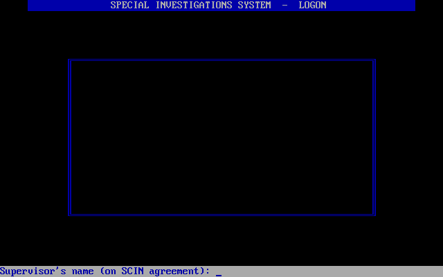
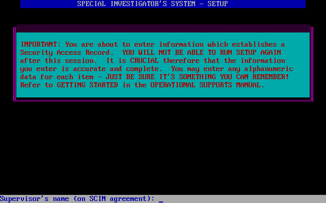
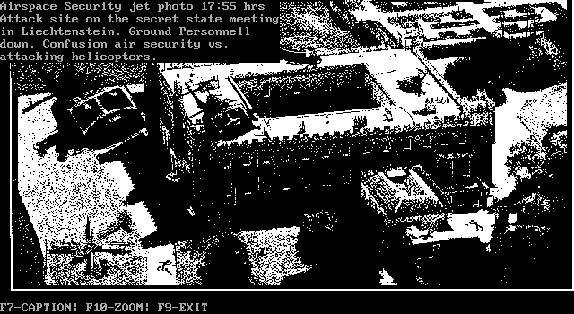
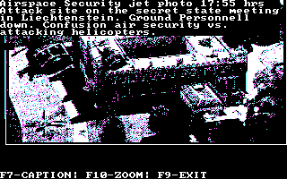
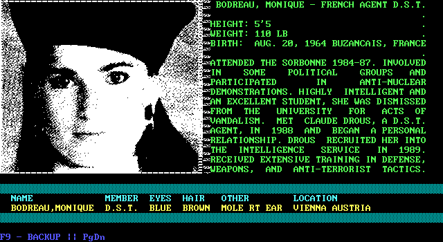
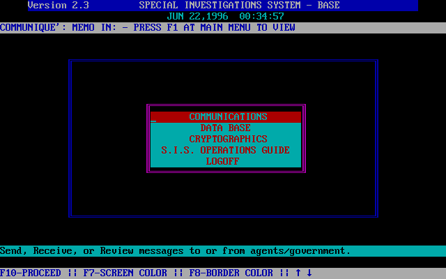

# The President Is Missing

*The President Is Missing* (Cosmi, 1988): concept by Paul Norman, the MS-DOS version by Ray
Hogue, as its credits say. You play an agent of the Special Investigations System, a
make-believe government network with menus for communications, a database of dossiers and
photographs, and cryptography. The box also held papers and an audio cassette, which a copy
of the game today keeps as PDFs and MP3s beside it.



## What's in the folder

The game ran from a hard disk, copied there from its floppies. The copy here, eXoDOS's, holds:

| File | What it is |
|---|---|
| `PRES.EXE` | The game, 31,920 bytes |
| `SU.EXE` | Setup, 4,054 bytes, which makes your profile |
| `SA` | The profile: your code name, your supervisor's name, and the rest you gave setup |
| `SA.B` | The profile as it shipped, before setup |
| `*.FIL`, `*.TBL` | The game's messages and its tables of them, with `*.TBB` copies of the tables as they shipped |
| `MUG001.PCC` to `MUG038.PCC` | The dossiers' mugshots |
| `PHOTO00.PCC` to `PHOTO07.PCC` | The photographs |
| `MUG.TXT`, `GUIDE.TXT`, `PROSEC.TXT` | The dossiers' text, the operations guide, and the prosecutor's summary |
| `SETUP.BAT`, `SETUP2.BAT`, `SIS.BAT`, `RESET.BAT` | The game's batch files |
| `R-PIM.COM` | A crack, added later; see below |

The pictures are PC Paintbrush files: 640 by 350 and one bit a pixel, the EGA's highest
resolution, in black and white.

The batch files show how it was meant to go. `SETUP.BAT` runs `SU`. Setup asks which drives
you have, and exits with the hard disk's letter as its exit code ('C' is 67). The batch file
then makes `C:\SIS` and copies the floppies into it. `SIS.BAT` runs the game. `RESET.BAT`
copies the `.TBB` tables and `SA.B` back over the played ones and runs setup again, for a new
investigation.

## The crack

Setup asks for the supervisor's name "on SCIN agreement", one of the papers in the box. That
was the protection: without the papers you couldn't make a profile, and without a profile
you couldn't log on. The name is in `SA.B` too, the profile the game shipped with:
`WILLIAM H. SULLENS`, beside a code name of `NOTSET`.



`R-PIM.COM` is the crack, a program by Rascal dated 1996, which patches `SU.EXE` on disk. It checks
that the file is 4,054 bytes long. Then it changes two bytes at offset AB9h from `75 03` to
`90 90`. In setup's code, that's here:

```
repe cmpsb        ; your answer against WILLIAM H. SULLENS, 18 characters
pop si
cmp cx, 0
jnz +3            ; 75 03: they differed, so on to the error and the question again
jmp next          ; they matched: on to your last name
```

With the `jnz` turned into two NOPs, every answer falls through to the `jmp`, and setup takes
any name at all. eXoDOS's copy of `SU.EXE` is the cracked one. The profile eXoDOS gives you
(code name `UNDERDOGS`) was made with it: its supervisor is `SCIN`, a name setup as shipped
would never take.

The check had a hole of its own. `repe cmpsb` stops at the first difference, or when it has
compared all 18 characters, and either way CX counts what's left. A difference in the last
character leaves CX at 0, just as a match does. So setup never checked the final S:
`WILLIAM H. SULLENX` gets through too.

### What Excavate does

Excavate runs `SU.EXE` unchanged, except for those two bytes. Each time DOS loads `SU.EXE`, it
puts `75 03` back in memory, if the crack's `90 90` is what's there. The file isn't touched,
and an uncracked copy is left as it is. So setup asks for William H. Sullens again, as it
shipped. Run it with

```
excavate president SU.EXE
```

The profile setup writes goes to the game's save folder, as everything the game writes does.
From then on the game logs on with it. eXoDOS's own profile still works too: the game itself
only compares your answers with whatever profile `SA` holds.

## The logon

The game asks for two things: your code name and your supervisor's name. DOS's line input
(INT 21h function 0Ah) reads each answer. The game uppercases it and compares it with the
profile.

There's a way around it. The routine that checks an answer
starts with `cmp word ptr [bx], 2121h`: two exclamation marks. Type `!!` as your code name,
and the game sets a flag and skips the rest of the logon, the supervisor's name included,
straight to the welcome.

## What it asks of the PC

- **A choice of display.** It starts with "ENTER 1 = CGA; 2 = EGA". On 2, it looks at the
  BIOS data area's byte at 0040:0087h, which an EGA's or VGA's BIOS sets. If that's 0, it
  quietly uses the CGA instead. Otherwise it asks the EGA's BIOS for its
  memory size (INT 10h function 12h), without setting BL to the subfunction that answers it.
- **Text, for nearly everything.** The menus, dossiers and messages are 80 by 25 text, drawn
  through the BIOS, with boxes, colors and blinking.
- **Graphics, for the pictures.** Each picture is unpacked in the CGA's 640-by-200 mode (6).
  Then the game switches to the EGA's 640-by-350 mode (10h) and writes it to the four planes,
  or, on the CGA, to the 320-by-200 mode (4). Captions are drawn through the BIOS, in the
  EGA's 8-by-14 font.
- **Names padded with spaces.** It opens `PHOTO00 .PCC` and `MUG003  .PCC`, with the spaces
  of a name stored in a directory entry, 8 characters and 3. DOS finds `PHOTO00.PCC`.
- **The BIOS's IRET.** It points the timer's hook (INT 1Ch) at F000:FF53h. That's where IBM's
  BIOS has an IRET, for interrupts that do nothing, and every compatible BIOS kept one there.
- **A BIOS that keeps its registers.** Its timer hook changes AX before it saves it. IBM's BIOS
  saves AX itself around the call, so on a PC that never mattered. In a BIOS that doesn't, a
  tick between the game's `mov ah, 2Ch` and its `int 21h` turns the call into another, and the
  game read keys into the middle of its own strings.







## Its own clock

The story has a clock, and the game borrows the PC's to keep it. At the end of `SA`, after a
`~` that ends the answers, are a date, a time and a BIOS tick count. The profile as it shipped
starts the story on June 22, 1996, at 00:30:45.



At logon the game keeps the PC's real date and tick count. Then it sets the clock to the
story's, three ways: the date through DOS (function 2Bh), the time through DOS (function 2Dh),
and the tick count through the BIOS (INT 1Ah function 01h). While you play, the PC's clock is
the story's, and the menus show it.

At logoff it saves the story's date and time back into the profile. Then it puts the real
clock back, moved on by the time you played. It reads the tick count, works out how many
ticks have passed since logon, and adds them to the real tick count it kept. A day's
rollover, which INT 1Ah reports, goes onto the real day of the month, without a check that
the month has that many days. Then it sets the real date. The story's clock only runs while
you play. `SIS.BAT` runs `DATE` and `TIME` after the game anyway, so you can check.

The time has a bug. The game saves DOS's time from function 2Ch with DX (seconds and
hundredths) where it later reads CX (hours and minutes), and the other way around. So at
logon it asks DOS for a time like 31:13, and DOS turns it down. The story's time survives
anyway, because the tick count it sets right after is the time, as far as DOS is concerned.

Excavate's DOS works as a PC's did for this. DOS's time is the BIOS's tick count, which starts
at the host's time of day, as DOS set it from the AT's clock at boot. DOS keeps the date
itself, starting at the host's, and moves it on a day when the tick count passes midnight.
Programs can set both. Your own computer's clock is never touched.

eXoDOS's copy has a curious sign of this clock. Many of its files are dated June 22, 1996:
the message tables and their `.TBB` copies, `AGENT.FIL` and `AGENT.FIB`, `START.EXE`, and
`R-PIM.COM` itself. That's the story's first day. It suggests the PC they were last written
on still had the game's date.
